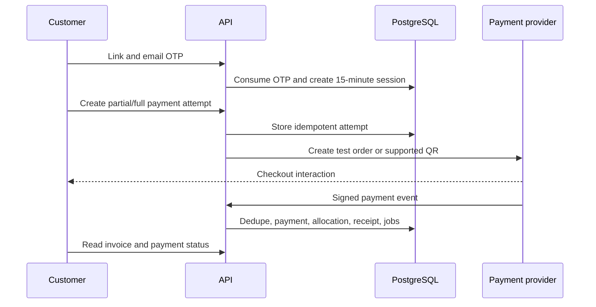

# Invoice SaaS — API Design v2.1
**27 October 2026 · REST / JSON · Design contract, not an implemented service**

## Agreed baseline — 27 October 2026

- Internal learning/testing MVP using simulated money only. All agreed web, Android and iOS features remain in the MVP; the refund mechanism is explicitly deferred. Delivery may be sequenced, but milestones do not remove agreed scope. Two weeks (~54 hours) is a progress checkpoint, not full-MVP completion acceptance.
- Monthly operating budget ceiling: **INR 5,000** across hosting, database, storage, email, backups and related operating services. Validate estimates before provisioning; no service tier or recovery target is assumed to fit without checking.
- One nonremoved vendor membership per login identity. One Owner/vendor; up to five active and fifteen existing Creators. Current ten-issued-invoices/month quota remains for internal testing; a separately issued replacement consumes quota and cancellation does not restore it.
- Only the related Vendor Owner can reset/replace Creator passwords. Creators have no password-change, initial-password-replacement, recovery, OTP-login or Google-login capability. Email verification remains separate from login.
- Creators retain their agreed own-draft/rework preparation rights. After issue, only the related Vendor Owner may modify an invoice, through a new immutable revision. Preserve original authorship, all prior snapshots/PDFs, payments and receipts. Reducing the collectible amount below allocations releases excess to customer credit; refunds are deferred.
- Sensitive fields requiring Platform Owner approval: legal business name, GSTIN, registered address, login email, contact email/mobile and payment details. Existing approved values stay effective pending approval; verify ownership of a changed email. Routine catalogue, price and tax-default settings remain Vendor Owner managed.
- Vendor Owner may correct customer email through an audited invoice-recipient correction; preserve historical recipient snapshots, revoke prior links/sessions, and send new access to the corrected recorded address. Changing the customer master alone does not silently rewrite issued history.
- Customers may request a fresh invoice link **including after full payment**. Each new link lasts **five days**; email OTP grants a fixed **15-minute session**, subject to earlier link expiry/revocation or eligibility loss. Renewals revoke prior access and are rate-limited/coalesced. Paid invoices remain viewable/downloadable; payment is offered only while outstanding is positive.
- Staff sessions: 24-hour absolute expiry and 30-minute idle timeout; no remember-me initially. OTP/reset-code validity remains five minutes; it is distinct from the customer session duration.
- Both Vendor Owner account recovery and vendor business-data backup/restore are required. Creator recovery remains Owner-controlled. Tenant-safe restore must preserve financial evidence and safely resume jobs without duplicate business effects.
- Still open: GST applicability, inclusive/exclusive pricing, rounding, numbering, backdating/correction policies; backup retention, acceptable data loss (RPO) and recovery time (RTO). These require explicit resolution before affected release/use; no specific values are approved here.

Aligned with Invoice-SaaS-PRD-v2, Architecture-v2-Brief and Database-Design-v2. Supersedes previous API proposals wherever behavior differs, including refund-in-MVP and Creator self-replacement contracts. This document defines the full agreed MVP scope except deferred refunds; the two-week checkpoint does not reduce required scope. Source filename remains v2 for continuity.

## 1. Quick overview
| Area | Main users | Coverage |
|---|---|---|
| Identity | Vendor Owner, Invoice Creator, Platform Owner | Signup, verification, password/Owner OTP/Google, sessions, recovery |
| Vendor administration | Vendor Owner / Platform Owner | Onboarding, sensitive approvals, Creator limits, block/restore |
| Master data | Vendor Owner | Customers, products/services, GST settings |
| Invoices | Owner / Creator | Draft, submit, rework, reject, approve and issue, PDF, corrections |
| Customer access | Customer | Five-day invoice link, OTP, fixed 15-minute session, immediate renewal |
| Collections | Customer / Owner / provider | Test checkout/UPI/QR, partial payment, verified outcomes, receipts |
| Financial exceptions | Owner / provider | Advances, credit, overpayments, disputes, reconciliation; refunds deferred |
| Automation | Owner / worker | Recurring drafts, reminders, email retries |
| Reports and operations | Owner / Platform Owner | Dashboards, reports, audit, delivery and job visibility |

**Base path:** /api/v1. All paths below are relative to it. Same backend contracts serve web and React Native. Platform administration is web-only. Customer browser access needs no account.

## 2. Authentication and authorization
| Label | Credential | Effective permission |
|---|---|---|
| Public | No authenticated session | Only explicit bootstrap/login/health endpoints; throttled |
| Owner | Opaque server-backed vendor session | Own vendor's approved business operations |
| Owner pending | Owner session for unapproved vendor | Onboarding, status, verification and logout only |
| Creator | Opaque server-backed vendor session | Own allowed invoice workflow; dropdown projections only |
| Restricted Creator | Email-unverified Creator session | Email verification, me/logout only; no password change/replacement |
| Platform Owner | Separate admin session | Platform reviews and operations; no implicit vendor finance adjustment |
| Link token | Opaque invoice-link secret | Request OTP/renewal only; not invoice viewing |
| Customer session | OTP-verified invoice session | One invoice and its scoped payment/documents only |
| Provider signature | Verified provider request | Ingress events only; not a user or tenant bearer token |

**Web:** Secure, HttpOnly cookies with SameSite policy and explicit Origin/CSRF checks on state-changing session routes. Session creation routes also validate trusted origin and login CSRF defenses. Customer and staff use separate cookie names and session stores. Never store session secrets in localStorage.

**Mobile:** Authorization: Bearer <opaque-session-token>, held in OS secure storage. It is not a JWT. No refresh-token endpoint is required for this server-session model. Reject conflicting cookie/bearer credentials. Administrative sessions are not issued to the mobile client flow; UI absence is not an authorization control.

**Current-state checks:** each request checks user/membership/vendor status and auth_version. Role and tenant come from the server session, never from body fields. Return 404 for inaccessible objects; return 403 for an authenticated role prohibited from a general operation.

**Agreed staff-session policy:** staff sessions expire after 24 hours, with a 30-minute idle limit; no remember-me in the pilot. OTP/reset grants expire after five minutes (implementation default, unchanged by the customer-session decision), OTPs permit five attempts and a resend after 60 seconds. Rate limits combine destination, session/link and IP, with configurable rolling hourly limits. These are security configuration values, not provider limits. Customer sessions remain exactly 15 minutes without sliding, and cannot outlive their link.

Creator visibility is always enforced in the query: own DRAFT/SUBMITTED/REWORK, plus own issued invoices with outstanding > 0. Hide Owner/recurring-origin, other creators', fully paid and rejected invoices. Query parameters cannot expand this scope. Creator does not receive management customer lists, financial reports, receipt access or general payment APIs.

## 3. Contract conventions
| Concern | Contract |
|---|---|
| IDs | Internal UUID strings; provider IDs are opaque strings, never UUID-validated |
| JSON naming | snake_case |
| Amounts | Exact decimal strings, e.g. "1250.00"; INR only initially; reject exponential notation and excessive precision |
| Quantity / unit price | Positive decimal quantity; unit price may have up to six fractional digits; totals rounded by configured calculation policy |
| Dates | YYYY-MM-DD; timestamps RFC 3339 UTC, e.g. 2026-10-16T12:00:00Z |
| Server-owned fields | id, vendor_id, original author, origin, totals, statuses, timestamps, external IDs, review actor and balances are not arbitrary client writes |
| Unknown properties | Reject with 422; never silently accept a Creator price/tax override |
| Pagination | cursor opaque, limit default 25/max 100; stable created_at,id ordering unless explicitly documented |
| List filters | Only filters listed for that endpoint; reject unsupported sorts/filters |
| Mutable resources | Include version where DB supports it; required version on listed commands/patches; stale version → 409 VERSION_CONFLICT |
| Lifecycle-only resources without version | Atomic state predicates/locks; do not invent updated_at-based concurrency |
| Timestamps | created_at and updated_at exposed on mutable resources; immutable records expose created_at and relevant event times only |
| Content | application/json except uploads, streamed downloads and provider raw-body ingress |
| Private responses | Cache-Control: no-store for auth/customer/sensitive responses; no shared cache of tenant data |
| Request tracing | Server-generated X-Request-ID, echoed in body meta; untrusted incoming IDs sanitized |
| Payload limits | Proposed JSON max 256 KiB; provider ingress separately bounded; asset max 5 MiB with byte/type inspection |

Normal success:
```json
{"data":{"id":"00000000-0000-4000-8000-000000000001"},"meta":{"request_id":"req_example"}}
```
List:
```json
{"data":[],"page":{"next_cursor":null,"has_more":false},"meta":{"request_id":"req_example"}}
```
Error:
```json
{"error":{"code":"VALIDATION_FAILED","message":"Correct the highlighted fields.","details":[{"field":"lines[0].quantity","code":"MUST_BE_POSITIVE"}]},"meta":{"request_id":"req_example"}}
```
204 has no body. Redirects, provider acknowledgements and binary downloads do not use the normal JSON envelope.

### Idempotency and concurrency
Require Idempotency-Key (UUID generated once per user action) on **all authenticated business POSTs**, signup, link renewal and customer payment-attempt creation. Auth login/verification/logout and webhook requests use their specific challenge/session/provider deduplication mechanisms instead. A retried identical request returns the original status/resource reference; current resource state is retrieved with GET. Same key with different payload → 409 IDEMPOTENCY_KEY_REUSED. Concurrent in-progress retry → 409 REQUEST_IN_PROGRESS plus Retry-After.

Scope keys to server actor + operation; customer payment scope binds to invoice and verified recipient so an expired session/new OTP does not create a new financial operation. Request hashes exclude transport credentials. Recheck authorization before replaying stored responses. Do not cache passwords/session secrets in idempotency result JSON. Keep durable financial dedupe references after ordinary response-cache expiry. Frontend disables repeated submission and reuses the same key after timeout; backend independently enforces constraints and locks.

PATCH uses version checks. DELETE is effect-idempotent: a repeated deletion under the same verified scope yields 204 where the removal is known; unknown/inaccessible IDs yield 404. Issue/revision/manual payment/reversal/credit commands additionally use domain uniqueness and locking.

## 4. Endpoint catalogue
Notation: {id} is a UUID unless stated otherwise. Request column lists required fields unless marked optional; schemas follow in section 5. List endpoints use standard pagination. Output names identify projections, not raw database rows. All mutating entries inherit idempotency/concurrency rules above.


### 4.1. Authentication and identity

| Method | Path | Access | Input | Success | Rules |
|---|---|---|---|---|---|
| POST | `/auth/signup` | Public | email,password | 201 OwnerBootstrap | One Owner and DRAFT vendor; no automatic Creator. |
| POST | `/auth/email-verifications` | Public/restricted | email,purpose=EMAIL_VERIFY | 202 ChallengeReceipt | Generic response; verification only, never Creator OTP login. |
| POST | `/auth/email-verifications/verify` | Public/restricted | challenge_id,code | 200 VerificationResult | Consume challenge; bind to intended identity. |
| POST | `/auth/login` | Public | email,password,client_type | 200 SessionResult | Password allowed for Owner/Creator/Platform Owner; unverified Creator gets an email-verification-only restricted session. Owner sets/replaces Creator credentials. |
| POST | `/auth/owner-otp/challenges` | Public | email | 202 ChallengeReceipt | Vendor Owner only; generic result for unknown/ineligible accounts. |
| POST | `/auth/owner-otp/verify` | Public | challenge_id,code,client_type | 200 SessionResult | No Creator or Platform Owner OTP login. |
| GET | `/auth/google/start` | Public | query: flow=LOGIN or SIGNUP,client_type,redirect_id | 302 redirect | Owner only; server allowlisted redirect, state, nonce and PKCE. |
| GET | `/auth/google/callback` | OAuth state | query: code,state | 303 redirect | Validate provider identity; no tokens in redirect URL; mobile gets single-use handoff code. |
| POST | `/auth/google/exchange` | Public + PKCE | handoff_code,code_verifier | 200 SessionResult | Mobile single-use exchange; never auto-link solely by email. |
| POST | `/auth/google/link` | Owner | google_authorization_code,code_verifier | 200 IdentityResult | Recent reauthentication; verified subject, reject identity already linked elsewhere. |
| POST | `/auth/password-recovery/challenges` | Public | email | 202 ChallengeReceipt | Owner/Platform Owner only; Creator receives no reset capability. |
| POST | `/auth/password-recovery/verify` | Public | challenge_id,code | 200 ResetGrant | Single-use short-lived grant, not normal session. |
| POST | `/auth/password-recovery/complete` | Reset grant | reset_grant,new_password | 204 | Consume grant and revoke existing sessions. |
| POST | `/auth/password/change` | Owner/Platform Owner | current_password,new_password | 204 | Creator excluded; invalidate prior sessions. |
| GET | `/auth/me` | Authenticated/restricted | none | 200 Actor | Role, membership, vendor state, restrictions; no credential data. |
| POST | `/auth/logout` | Authenticated/restricted | none | 204 | Revoke current session and clear cookie. |
| GET | `/auth/sessions` | Authenticated | none | 200 SessionList | Own device/session metadata only. |
| DELETE | `/auth/sessions/{id}` | Authenticated | none | 204 | Own session only; Creator may revoke sessions, not reset password. |

### 4.2. Vendor onboarding and Creator management

| Method | Path | Access | Input | Success | Rules |
|---|---|---|---|---|---|
| GET | `/vendor` | Owner | none | 200 Vendor | Pending Owner can inspect onboarding. |
| PATCH | `/vendor/onboarding` | Owner pending | ProfileDraft + version | 200 Vendor | Editable DRAFT/MORE_INFO/REJECTED; no approved profile overwrite. |
| POST | `/vendor/onboarding/submit` | Owner pending | version | 200 ChangeRequest | Idempotent; require verified email and valid business profile. |
| GET | `/vendor/profile` | Owner | none | 200 VendorProfile | Approved profile plus separately identified pending changes. |
| PATCH | `/vendor/profile` | Owner | NonSensitiveProfilePatch + version | 200 VendorProfile | Only allowlisted nonsensitive fields; sensitive fields return approval-required error. |
| POST | `/vendor/change-requests` | Owner | kind,base_profile_id,proposed_changes | 201 ChangeRequest | Preserve active values; LOGIN_EMAIL explicit distinction from business contact email. |
| POST | `/vendor/change-requests/{id}/email-verifications` | Owner | none | 202 ChallengeReceipt | Destination taken from proposed new email, never a new request email. |
| POST | `/vendor/change-requests/{id}/email-verifications/verify` | Owner | challenge_id,code | 200 ChangeRequest | Verification is necessary but does not approve change. |
| GET | `/vendor/change-requests` | Owner | list filters | 200 ChangeRequestList | Review status and reason. |
| GET | `/vendor/usage` | Owner | query: month=YYYY-MM | 200 Usage | Issued count/limit/remaining and Asia/Kolkata period. |
| GET | `/vendor/creators` | Owner | list filters | 200 CreatorList | ACTIVE/FROZEN managed accounts; excludes removed historical authors. |
| POST | `/vendor/creators` | Owner | email,password,status | 201 Creator | 5 ACTIVE/15 existing; proposed status ACTIVE or FROZEN; Owner sets password; email verification only; never return password. |
| POST | `/vendor/creators/{id}/reset-password` | Owner | new_password | 204 | Owner directly replaces password and revokes sessions; Owner communicates the replacement credential securely; no Creator replacement step. |
| POST | `/vendor/creators/{id}/freeze` | Owner | version,reason | 200 Creator | Immediate access revocation; still counts toward 15. |
| POST | `/vendor/creators/{id}/unfreeze` | Owner | version | 200 Creator | Enforce active cap under lock. |
| DELETE | `/vendor/creators/{id}` | Owner | none | 204 | Hard-delete unreferenced; otherwise remove access and preserve minimal historical membership. |

### 4.3. Customers, catalogue and GST

| Method | Path | Access | Input | Success | Rules |
|---|---|---|---|---|---|
| GET | `/customers` | Owner | list filters: q,status | 200 CustomerList | Full tenant customer management view. |
| POST | `/customers` | Owner | CustomerInput | 201 Customer | No customer login account. |
| GET | `/customers/{id}` | Owner | none | 200 Customer | Tenant scoped. |
| PATCH | `/customers/{id}` | Owner | CustomerPatch + version | 200 Customer | Changes future customer selection only; use invoice recipient-email correction for already issued invoices. Preserve prior snapshots. |
| POST | `/customers/{id}/archive` | Owner | version | 200 Customer | Disable future selection; preserve history. |
| GET | `/invoice-options/customers` | Owner/Creator | query: q,cursor,limit | 200 CustomerOptionList | Active dropdown projection only; no customer balances/history. |
| GET | `/invoice-options/items` | Owner/Creator | query: q,cursor,limit | 200 ItemOptionList | Active selectable items, units and displayed configured price/tax; no editing. |
| GET | `/catalogue-items` | Owner | list filters | 200 CatalogueList | Owner management view. |
| POST | `/catalogue-items` | Owner | CatalogueInput | 201 CatalogueItem | Validate price, unit and same-tenant tax profile. |
| PATCH | `/catalogue-items/{id}` | Owner | CataloguePatch + version | 200 CatalogueItem | Updates future drafts only; no issued snapshot edits. |
| POST | `/catalogue-items/{id}/archive` | Owner | version | 200 CatalogueItem | Historical references retained. |
| GET | `/tax-profiles` | Owner | list filters | 200 TaxProfileList | GST identity is separate from rate configuration. |
| POST | `/tax-profiles` | Owner | TaxProfileInput | 201 TaxProfile | Validated configured tax components. |
| PATCH | `/tax-profiles/{id}` | Owner | TaxProfilePatch + version | 200 TaxProfile | New calculations use new version; issued calculations remain. |
| POST | `/tax-profiles/{id}/archive` | Owner | version | 200 TaxProfile | Reject if active default still references it until default changed. |

### 4.4. Invoices and documents

| Method | Path | Access | Input | Success | Rules |
|---|---|---|---|---|---|
| GET | `/invoices` | Owner/Creator | list filters: approval_state,document_state,payment_status,customer_id,from,to | 200 InvoiceList | Creator filter always ANDed with server visibility rule. |
| POST | `/invoices/preview` | Owner/Creator | InvoiceDraftInput | 200 InvoicePreview | No persistence/quota; Creator overrides rejected. |
| POST | `/invoices` | Owner/Creator | InvoiceDraftInput | 201 Invoice | Author/origin derived from actor; DRAFT. |
| GET | `/invoices/{id}` | Owner/Creator | none | 200 Invoice | Invisible objects return 404, even with known UUID. |
| PATCH | `/invoices/{id}` | Owner/eligible Creator | InvoiceDraftPatch + version | 200 Invoice | Creator only own DRAFT/REWORK; Owner unissued only. |
| DELETE | `/invoices/{id}` | Owner/eligible Creator | none | 204 | Only own never-submitted DRAFT for Creator; Owner only never-issued/unreferenced draft; audit retained. |
| POST | `/invoices/{id}/submit` | Creator | version | 200 Invoice | Own DRAFT/REWORK to SUBMITTED; server revalidates current catalogue. |
| POST | `/invoices/{id}/request-changes` | Owner | version,reason | 200 Invoice | SUBMITTED to REWORK; notify Creator. |
| POST | `/invoices/{id}/reject` | Owner | version,reason | 200 Invoice | Unissued submitted/rework; hides from Creator and notifies reason. |
| POST | `/invoices/{id}/approve-and-issue` | Owner | version | 200 Invoice | Own draft or reviewed submitted invoice; snapshot/number/quota/jobs atomic. |
| POST | `/invoices/{id}/cancel` | Owner | version,reason | 200 Invoice | Issued unpaid only, no active allocations/unresolved attempts; quota not returned. |
| POST | `/invoices/{id}/replacements` | Owner | version,reason,draft | 201 Invoice | Only unpaid, no unresolved attempt; creates linked replacement draft; old invoice superseded atomically when replacement issues. |
| POST | `/invoices/{id}/revisions` | Owner | version,reason,draft | 201 InvoiceRevision | Issued including paid/part-paid; append immutable revision, preserve old PDFs/payments, adjust allocations/credit atomically; no refund. Reject unresolved payment attempts until reconciled. |
| GET | `/invoices/{id}/revisions` | Owner/eligible Creator | list pagination | 200 InvoiceRevisionList | Parent visibility applies; Creator receives sanitized allowed invoice snapshots only; prior snapshots cannot be overwritten. |
| POST | `/invoices/{id}/recipient-email` | Owner | version,email,reason | 200 Invoice | Audited recipient-only revision; revoke links/sessions/challenges and queue new five-day link to corrected email; preserve original recipient. |
| GET | `/invoices/{id}/history` | Owner/eligible Creator | list pagination | 200 InvoiceActionList | Creator sees only allowed invoice and sanitized review history. |
| POST | `/invoices/{id}/delivery` | Owner | none | 202 DeliveryResult | Recheck eligibility; email protected link to recorded invoice recipient. |
| GET | `/invoices/{id}/documents` | Owner/eligible Creator | none | 200 DocumentList | Creator invoice PDF only while invoice visible. |
| GET | `/documents/{id}/content` | Owner/eligible Creator | none | 200 binary PDF/image | Authorize parent and document kind; 409 DOCUMENT_NOT_READY until generated. |
| POST | `/vendor/assets` | Owner | multipart: file,kind=LOGO or QR_UPLOAD | 201 Document | Validate bytes/type/size; proposed profile references asset; arbitrary QR never confirms payment. |

### 4.5. Customer link and invoice access

| Method | Path | Access | Input | Success | Rules |
|---|---|---|---|---|---|
| POST | `/public/invoice-links/inspect` | Link token | link_token | 200 LinkStatus | Minimal VALID/EXPIRED/UNAVAILABLE; no invoice/customer details before OTP. |
| POST | `/public/invoice-links/otp` | Link token | link_token | 202 ChallengeReceipt | Send to stored recipient only; eligible unexpired link. |
| POST | `/public/invoice-links/verify` | Link token + OTP | link_token,challenge_id,code | 200 CustomerSessionResult | Fixed 15-minute session, bound to link and invoice. |
| POST | `/public/invoice-links/renew` | Link token, valid or expired | link_token | 202 Accepted | Fresh five-day link emailed immediately after checks, including paid invoices; no Owner approval; generic response. |
| GET | `/customer/invoice` | Customer session | none | 200 CustomerInvoice | Only session invoice; no invoice ID selector. |
| GET | `/customer/invoice/documents` | Customer session | none | 200 DocumentList | Invoice PDF/current revision and invoice-scoped receipts/credits only, including after full payment. |
| GET | `/customer/documents/{id}/content` | Customer session | none | 200 binary PDF | Verify document belongs to session invoice; no public S3 redirect. |
| POST | `/customer/payment-attempts` | Customer session | amount,method | 202 PaymentAttempt | Positive amount ≤ outstanding; one unresolved attempt per invoice. |
| GET | `/customer/payment-attempts/{id}` | Customer session | none | 200 PaymentAttempt | Attempt must belong to session invoice; polling does not extend session. |
| POST | `/customer/payment-attempts/{id}/checkout-result` | Customer session | provider_order_id,provider_payment_id,provider_signature | 202 Accepted | A hint for server verification/reconciliation, never client-confirmed funds. |
| GET | `/customer/invoice/payments` | Customer session | list pagination | 200 ScopedPaymentList | Amounts applied here only; hide other invoices, credits and provider secrets. |
| POST | `/customer/logout` | Customer session | none | 204 | Revoke customer session. |

### 4.6. Payments, adjustments and receipts

| Method | Path | Access | Input | Success | Rules |
|---|---|---|---|---|---|
| GET | `/payments` | Owner | list filters: customer_id,source,from,to | 200 PaymentList | Confirmed ledger, not failed attempts. |
| GET | `/payments/{id}` | Owner | none | 200 Payment | Includes allocations, reversals and available customer-credit amounts; no refund action in MVP. |
| GET | `/payment-attempts` | Owner | list filters: invoice_id,status | 200 PaymentAttemptList | Failed/pending/unknown attempts visible. |
| GET | `/payment-attempts/{id}` | Owner | none | 200 PaymentAttempt | No secrets; preserve simulation/source labels. |
| POST | `/customers/{id}/advance-attempts` | Owner | amount,method | 202 PaymentAttempt | TEST-only advance; no new customer-wide portal grant. |
| POST | `/payments/manual` | Owner | ManualPaymentInput | 201 Payment | Supplementary bank/cash TEST record; no manual UPI-confirmation shortcut. |
| POST | `/payments/{id}/allocations` | Owner | allocations[]: invoice_id,amount | 201 AllocationBatch | Same customer/currency, positive totals, atomic cap checks. |
| POST | `/allocations/{id}/reverse` | Owner | reason,replacement_allocations[] optional | 201 AllocationReversalResult | Full reversal once; optional replacement batch committed together. |
| POST | `/payments/{id}/reverse-manual` | Owner | reason | 201 PaymentReversal | Erroneous manual entry only; reverse allocations atomically; provider payment cannot use this. |
| POST | `/invoices/{id}/credit-notes` | Owner | CreditNoteInput | 201 CreditNote | Draft reduction with line tax detail; immutable after issue. |
| PATCH | `/credit-notes/{id}` | Owner | CreditNotePatch + version | 200 CreditNote | DRAFT only. |
| POST | `/credit-notes/{id}/issue` | Owner | version,allocation_adjustments[] optional | 200 CreditNote | Cap standalone credits against current collectible; revision-linked notes are system-created with the revision transaction. Release excess allocations atomically or fail with adjustment-required. |
| GET | `/credit-notes` | Owner | list filters: invoice_id,status | 200 CreditNoteList | Issued originals preserved. |
| GET | `/credit-notes/{id}` | Owner | none | 200 CreditNote | Line-level breakdown and document references. |
| GET | `/disputes` | Owner | list filters: payment_id,status | 200 DisputeList | Provider/fixture evidence only. |
| GET | `/disputes/{id}` | Owner | none | 200 Dispute | Includes event timeline; no arbitrary status patch. |
| GET | `/receipts` | Owner | list filters: payment_id | 200 ReceiptList | Full payment receipts for Owner only. |
| GET | `/receipts/{id}` | Owner | none | 200 Receipt | Private document reference, snapshot and void state. |
| GET | `/reconciliation-cases` | Owner | list filters: status,kind | 200 ReconciliationList | Excess, unknown and financial mismatch cases. |
| POST | `/reconciliation-cases/{id}/recheck` | Owner | none | 202 Accepted | Queue verification, never blindly repeat payment/refund request. |
| POST | `/reconciliation-cases/{id}/resolve` | Owner | resolution,related_adjustment_ids[] | 200 ReconciliationCase | Validate evidence and balances; closing case itself moves no money. |

**Deferred refund API (post-MVP, not mounted/enabled):** POST /payments/{id}/refunds; GET /refunds; GET /refunds/{id}. No refund UI, worker command or acceptance requirement is included in the current MVP. Unexpected provider refund evidence is retained for reconciliation, without enabling a refund mechanism.

### 4.7. Automation, reporting and delivery visibility

| Method | Path | Access | Input | Success | Rules |
|---|---|---|---|---|---|
| GET | `/recurring-schedules` | Owner | list filters | 200 ScheduleList | Owner-created recurring drafts only. |
| POST | `/recurring-schedules` | Owner | ScheduleInput | 201 Schedule | Validate customer/items/template; no automatic debit. |
| GET | `/recurring-schedules/{id}` | Owner | none | 200 Schedule | Includes next_due_at, version. |
| PATCH | `/recurring-schedules/{id}` | Owner | SchedulePatch + version | 200 Schedule | active=false pauses; no replay of prior occurrences. |
| GET | `/recurring-schedules/{id}/occurrences` | Owner | list pagination | 200 OccurrenceList | Generated/skipped/failed occurrences with draft IDs. |
| GET | `/reminder-rules` | Owner | none | 200 ReminderRuleList | Days relative to invoice due date. |
| POST | `/reminder-rules` | Owner | offset_days,active | 201 ReminderRule | Unique offset per vendor. |
| PATCH | `/reminder-rules/{id}` | Owner | offset_days optional,active optional,version | 200 ReminderRule | Does not replay delivered reminders. |
| PATCH | `/invoices/{id}/reminders` | Owner | paused,version | 200 Invoice | Pause/resume future eligible reminders. |
| GET | `/invoices/{id}/deliveries` | Owner | list pagination | 200 DeliveryList | Invoice/reminder/receipt delivery status and redacted errors. |
| GET | `/dashboard` | Owner | query: from,to | 200 Dashboard | Approvals, invoiced, collected, outstanding, overdue and quota. |
| GET | `/reports/{type}` | Owner | type=INVOICES/PAYMENTS/CUSTOMERS/AGEING; query: from,to,as_of,cursor,limit | 200 ReportPage | Allowlisted type, exact totals, stable definitions. |
| GET | `/audit-events` | Owner | list filters: entity_type,entity_id,from,to | 200 AuditEventList | Tenant only; no OTP/token/payment-secret payloads. |

### 4.8. Platform administration and integrations

| Method | Path | Access | Input | Success | Rules |
|---|---|---|---|---|---|
| GET | `/admin/dashboard` | Platform Owner | query: from,to | 200 AdminDashboard | Vendor status/reviews, activity, failed jobs; collections not SaaS revenue. |
| GET | `/admin/vendors` | Platform Owner | list filters: status,q | 200 VendorList | Cross-tenant administrative projection. |
| GET | `/admin/vendors/{id}` | Platform Owner | none | 200 VendorReview | Profile, changes, counts; no login or provider secrets. |
| GET | `/admin/change-requests` | Platform Owner | list filters: status,kind,vendor_id | 200 ChangeRequestList | Onboarding and sensitive approvals. |
| POST | `/admin/change-requests/{id}/review` | Platform Owner | version,decision=APPROVE/REJECT/MORE_INFO,reason | 200 ChangeRequest | Check fresh base profile/email verification; activate approved values atomically. |
| POST | `/admin/vendors/{id}/block` | Platform Owner | version,reason | 200 Vendor | Revoke access, notify, preserve in-flight confirmations/history. |
| POST | `/admin/vendors/{id}/restore` | Platform Owner | version,reason | 200 Vendor | Restore previous eligible lifecycle; do not unfreeze creators. |
| GET | `/admin/jobs` | Platform Owner | list filters: status,kind,vendor_id | 200 JobList | Sanitized operational failures only. |
| POST | `/admin/jobs/{id}/retry` | Platform Owner | reason | 202 Accepted | Only safely retryable jobs; unknown financial effects must reconcile first. |
| GET | `/admin/provider-events` | Platform Owner | list filters: status,provider | 200 EventList | Redacted event metadata and matching failures. |
| POST | `/admin/provider-events/{id}/reprocess` | Platform Owner | reason | 202 Accepted | Use same deduplicating handler; never edit signed event payload. |
| GET | `/admin/email-suppressions` | Platform Owner | list filters | 200 SuppressionList | Restricted operations view; no cross-vendor public disclosure. |
| POST | `/admin/email-suppressions/{id}/clear` | Platform Owner | reason | 200 Suppression | Only after remediation; audit and synchronize provider suppression policy. |
| GET | `/admin/audit-events` | Platform Owner | list filters | 200 AuditEventList | Administrative audit, redacted. |
| POST | `/webhooks/razorpay` | Provider signature | raw provider body | 200 acknowledgement | Durable inbox then processing; no user session/CSRF required. |
| POST | `/webhooks/ses-sns` | SNS signature + topic allowlist | SNS envelope | 200 acknowledgement | Verify before parsing trusted event; validated subscription confirmations handled separately. |
| GET | `/health/live` | Public | none | 200 Health | Process alive only; no infrastructure details. |
| GET | `/health/ready` | Internal monitoring | none | 200 or 503 Health | Database/migration readiness; not a public diagnostics endpoint. |

## 5. Request schemas and response projections
Fields marked ? are optional. All other fields below are required. PATCH accepts a nonempty subset of the relevant writable fields plus version. Omitting a property preserves it; null is accepted only where the underlying field is nullable. IDs must refer to eligible records in the current tenant.

| Schema | Fields / validation |
|---|---|
| ProfileDraft | business_name, address, contact_email; contact_mobile?, gstin?, default_tax_profile_id?, payment_details?, qr_document_id? |
| Address | line1, city, state_code, postal_code, country_code="IN"; line2? |
| NonSensitiveProfilePatch | default_tax_profile_id?, version; business_name/legal name, address/registered address, gstin, login/contact email, contact mobile and payment details require Platform Owner approval |
| Sensitive proposed_changes | Only fields permitted by kind: LOGIN_EMAIL, CONTACT_EMAIL, CONTACT_MOBILE, PAYMENT_DETAILS or configured BUSINESS_IDENTITY change; reject mixed unknown fields |
| CustomerInput | name, email, address; phone?, gstin?; status defaults ACTIVE |
| CatalogueInput | name, item_type=PRODUCT/SERVICE, unit, unit_price; sku?, tax_profile_id?, hsn_sac?; active defaults true |
| TaxProfileInput | name, mode, components, calculation_version; active defaults true; configuration validated against implemented tax policy |
| InvoiceDraftInput | customer_id, invoice_date, due_date?, lines[]; Owner-only overrides? |
| Creator invoice line | catalogue_item_id, quantity ONLY; no unit_price/discount/tax/description override |
| Owner overrides | Per-line unit_price?, discount_amount?, tax_profile_id?; invoice tax_profile_id?; all tax/totals computed by backend |
| ManualPaymentInput | customer_id, amount, currency="INR", method=BANK/CASH, received_at, reference; allocations[] optional; source assigned MANUAL_TEST |
| CreditNoteInput | reason, lines[] of invoice_line_id?, description, net_amount, tax_amount; backend checks relevant preserved revision/line/tax caps and derives total; revision-linked notes are created only by the revision command |
| ScheduleInput | customer_id, frequency=WEEKLY/MONTHLY, interval_count positive integer, next_due_at, template={lines, due_days}; active? default true; timezone fixed Asia/Kolkata |
| Payment attempt input | amount decimal > 0, method=CHECKOUT_UPI/PROVIDER_QR; invoice and customer derived from customer session; currency server-assigned |
| Deferred post-MVP Refund input | amount > 0, reason, credit_note_id?; source payment from path; validate funds after pending reservations |
| Change review | version, decision; reason required for REJECT/MORE_INFO and retained for APPROVE when provided |
| Asset upload | multipart file; kind; PNG/JPEG for QR/logo, validate actual bytes and safe dimensions; no arbitrary remote URL fetch |

**Tax precedence:** Owner invoice-specific tax profile → selected item's configured tax profile → vendor default; invoice-specific Owner per-line tax profile takes precedence over the invoice profile. Creator cannot set any overrides. This ordering clarifies ambiguous multiple defaults and must match the tax engine. Changes to product/tax configuration after a saved draft require re-preview and explicit resubmission/review; never silently issue stale or altered totals.

**Account email versus business contact email:** the former identifies users.email; the latter belongs to the vendor profile. They can differ. A login-email change updates identity and approved profile only where explicitly requested, checks uniqueness and revokes sessions. A contact-email change alone never changes login credentials.

| Projection | Returned data |
|---|---|
| Actor | user_id, role, membership_id?, vendor_id?, vendor_status?, email, restricted, required_actions; no password/hash |
| SessionResult | actor, expires_at; mobile only session_token; web cookie set by response |
| OwnerBootstrap | user_id, vendor_id, vendor_status=DRAFT, required_actions; restricted onboarding cookie/session |
| ChallengeReceipt | opaque challenge_id, expires_in_seconds, resend_after_seconds; generic for unknown email; never OTP value |
| VerificationResult | verified boolean, required_actions; does not imply vendor approval |
| ResetGrant | reset_grant, expires_at; only after successful recovery OTP |
| Vendor / VendorProfile | id, approved business/contact projection, status, current_profile_id, pending_request_summary, version, timestamps; payment details masked |
| Creator | membership_id, email, status, version, timestamps; no password or historical removed identity PII |
| CustomerOption | id, name, masked_email; enough to select, no unrelated balances/history |
| ItemOption | id, name, unit, unit_price, tax_display, catalogue_version |
| Invoice / InvoiceList item | id, invoice_number?, origin, author reference, customer summary, approval_state, document_state, payment_status, total, credited, allocated, outstanding, currency, version, timestamps; detail adds lines, snapshots and allowed_actions |
| CustomerInvoice | invoice number, approved seller snapshot, invoice recipient snapshot, lines/tax/totals, outstanding, allowed payment methods, document states; no internal audit/creator identifiers |
| PaymentAttempt | id, status, amount, currency, method, expires_at, mode=TEST, integration_source, checkout? or qr?, failure_code?; no provider secret |
| Payment | id, amount, currency, source, method, received_at, allocations, reversed_amount, available_amount, created_at; refunded_amount/reserved_refund_amount are deferred post-MVP |
| ScopedPayment | payment reference, applied_amount_for_this_invoice, received_at, relevant reversal/refund state; no unrelated payment allocations or customer balance |
| Deferred post-MVP Refund | id, payment_id, amount, status, source/mode, reason, requested_at, completed_at?, created_at, updated_at |
| Receipt | id, number, payment_id, amount_snapshot, issued_at, voided_at?, document_id?; Customer gets separately scoped projection |
| InvoiceRevision | id, invoice_id, revision_no, previous_revision_id?, reason, total, signed_total_delta, issued snapshot/lines and document references, created_at; sanitize for Creator permissions |
| CreditNote | id, invoice_id, invoice_revision_id?, number?, status, lines, amount, reason, version, issued_at?, timestamps |
| Document | id, kind, status, mime_type, byte_size?, content_version, created_at, updated_at; authorized content endpoint, never bucket/key/secrets |
| Schedule / Occurrence | configuration/version/timestamps; occurrence includes scheduled_for, status, invoice_id?, reason? |
| Delivery | template, status, accepted_at?, delivered_at?, sanitized_error?; no encrypted payload/provider credentials |
| Usage | month, timezone, issued_count, limit=10, remaining; historical quota may differ if future plans added |
| Job / Event | id, kind/type, status, attempts where relevant, redacted error, timestamps; encrypted payload never exposed |
| Accepted / DeliveryResult | accepted=true, operation_id or job reference where safe; actual asynchronous result polled through resource GET |
| Dashboard / ReportPage | period, as_of, currency, measures, rows as applicable, calculation_basis; collection totals clearly labelled test |
| Other resource projections | Public scalar fields from corresponding DB entity plus authorized parent IDs, statuses/timestamps; explicitly omit ciphertext, token hashes, secrets, raw provider payloads, private storage keys and unrelated tenant identifiers |

### Concrete request and response examples
UUIDs below are illustrative placeholders, not existing records.

**Creator creates an invoice draft**
```http
POST /api/v1/invoices
Content-Type: application/json
Idempotency-Key: 49ba87dc-5448-468d-a987-ffb632cf0ea3
```
```json
{
  "customer_id":"00000000-0000-4000-8000-000000000002",
  "invoice_date":"2026-10-16",
  "due_date":"2026-10-30",
  "lines":[{"catalogue_item_id":"00000000-0000-4000-8000-000000000003","quantity":"2.000000"}]
}
```
```json
{
  "data":{
    "id":"00000000-0000-4000-8000-000000000004",
    "invoice_number":null,
    "origin":"CREATOR",
    "approval_state":"DRAFT",
    "document_state":"UNISSUED",
    "payment_status":"UNPAID",
    "currency":"INR",
    "subtotal":"1000.00",
    "tax_total":"180.00",
    "total":"1180.00",
    "outstanding":"1180.00",
    "version":1,
    "created_at":"2026-10-16T12:00:00Z",
    "updated_at":"2026-10-16T12:00:00Z"
  },
  "meta":{"request_id":"req_example"}
}
```
The displayed tax is illustrative, not a universal GST rate. An unissued total is not yet collectible. For a draft, outstanding is a preview only; reports exclude it from receivables.

**Submit and issue:** Creator POST /invoices/{id}/submit with {"version":1}. Owner then POST /invoices/{id}/approve-and-issue with the latest version. The response includes invoice_number, issued_at, incremented version, approval_state=APPROVED, document_state=ISSUED and document/delivery status. A PDF/email failure never rolls back or repeats issuance.

**Customer partial-payment request**
```json
{"amount":"400.00","method":"CHECKOUT_UPI"}
```
202 response:
```json
{
  "data":{
    "id":"00000000-0000-4000-8000-000000000005",
    "status":"CREATING",
    "amount":"400.00",
    "currency":"INR",
    "method":"CHECKOUT_UPI",
    "mode":"TEST",
    "integration_source":"PROVIDER_TEST",
    "checkout":null
  },
  "meta":{"request_id":"req_example"}
}
```
Poll attempt GET until PENDING plus checkout configuration, or a confirmed terminal state. checkout contains only public key ID, provider order ID, amount in provider minor units and allowed presentation details; API money remains decimal strings. Provider QR configuration is issued only where supported. Unsupported method returns 422 PAYMENT_METHOD_UNAVAILABLE; never silently swap to a fake QR.

On verified ₹400 success against ₹1,180, invoice totals become allocated="400.00", outstanding="780.00", payment_status=PARTIALLY_PAID. The receipt and customer/Owner notifications are queued once.

**Allocation correction**
```json
{
  "reason":"Applied to the wrong invoice",
  "replacement_allocations":[
    {"invoice_id":"00000000-0000-4000-8000-000000000006","amount":"400.00"}
  ]
}
```
POST /allocations/{id}/reverse appends a full reversal and optional new allocations atomically. It returns reversal_id and allocation IDs. It never calls a refund API.

**Deferred refund example — post-MVP only; endpoint not enabled**
```json
{"amount":"200.00","reason":"Agreed reduction after credit note","credit_note_id":"00000000-0000-4000-8000-000000000007"}
```
POST /payments/{id}/refunds returns 202 with refund status REQUESTED. A timeout becomes UNKNOWN, not FAILED. If money is still allocated, return 409 FUNDS_STILL_ALLOCATED with safe required-adjustment details; do not silently unpay unrelated invoices.

## 6. Workflow and state rules
### Signup and Creator login
1. Owner signs up, verifies email, completes onboarding and submits.
2. Platform Owner approves/rejects/requests more information. Until approval, Owner gets onboarding-only access.
3. Owner creates Creator and sets their password. System never auto-creates one; Creator cannot independently change or replace the password.
4. Creator verifies their email separately. A verification-only restricted session has no password-change capability; only the related Vendor Owner resets/replaces credentials.
5. Subsequent login is password only. Forgotten password is handled by Vendor Owner; public recovery responses reveal neither Creator identity nor role.

Google signup follows the same onboarding workflow. Existing account linking needs authenticated re-verification; a matching Google email alone cannot change roles, attach a Creator or bypass approval.

### Invoice transitions
| Current state | Actor / command | Result |
|---|---|---|
| DRAFT | Creator submit | SUBMITTED; editing locked |
| SUBMITTED | Owner request-changes | REWORK; Creator may edit/resubmit |
| SUBMITTED/REWORK | Owner reject | REJECTED; notify reason; hidden from Creator |
| DRAFT owned by Owner / SUBMITTED | Owner approve-and-issue | APPROVED + ISSUED; snapshot/number/quota committed once |
| ISSUED with no allocations/unresolved attempts | Owner cancel | CANCELLED; keep original and quota consumption |
| ISSUED unpaid | Owner creates replacement | New linked draft; original stays current until atomic replacement issuance |
| Any ISSUED, including paid/part-paid | Related Owner publishes revision | Append immutable revision and financial adjustment evidence; preserve originals/payments/receipts; release excess allocations to customer credit without refund |

approval_state and document_state are separate from derived payment_status. The contract uses DRAFT/SUBMITTED/REWORK/APPROVED/REJECTED and UNISSUED/ISSUED/CANCELLED/SUPERSEDED; synchronize exact enum labels in migrations. Draft deletion does not erase submitted review history.

### Customer and payment journey

If the session expires during checkout, provider handling continues. Customer re-verifies OTP to see the result; the browser does not need to remain connected. A payment callback arriving after logout is not needed to confirm the payment.

Renewal accepts an eligible valid or expired link, including a fully paid invoice, sends a fresh five-day link immediately to its current recorded invoice email, revokes prior links/sessions and requires OTP again. It never accepts a replacement recipient address. Repeated requests are coalesced during cooldown; do not continually revoke a newly emailed link because someone replays the old expired token. Invalid/revoked/blocked links receive a generic response with no data. Service acceptance means queued immediately, not a guarantee of immediate email delivery.

### Advances, overpayments and disputes
- Advance is an unallocated confirmed payment; Owner may create a test advance checkout. It does not introduce account-wide customer portal access.
- Excess success is retained in full, only current outstanding is allocated, and remaining customer credit/reconciliation is visible to Owner.
- Customer session never permits browsing other invoices to allocate credit.
- **Post-MVP refund design only:** refunds reserve funds while REQUESTED/PROCESSING/UNKNOWN; only verified failure releases the reservation. Provider refunds never use a manual success toggle.
- Dispute events change case status; confirmed chargebacks/restorations create separate funds adjustments. Opening a dispute alone does not create another refund or silently erase an allocation.
- Owner performs financial corrections through explicit commands. Platform operational replay cannot bypass these constraints.
- **Post-MVP only:** manual refund confirmation in TEST must use a clearly labelled fixture harness or verified manual evidence workflow; no general client status PATCH exists.

### Issued revisions, recipient corrections and recovery
POST /invoices/{id}/revisions takes the current resource version, a required reason and an Owner-authorized invoice draft payload. Only the related Vendor Owner may invoke it. Lock the customer, invoice and affected payments in deterministic order. Reject changes of vendor/customer identity and unresolved payment attempts; correct an email with the recipient endpoint. Changing the billed legal customer or statutory document identity requires the still-open tax/correction policy.

Create revision 1 at initial issuance. Later revisions snapshot all header/line/tax/recipient values, signed total delta, actor and reason; preserve every prior PDF. A positive delta increases debt; a negative delta is accompanied by a linked credit note and releases excess allocations atomically into customer credit. Current collectible amount = latest revision total minus standalone issued credit notes; exclude revision-linked credit notes from that subtraction because the revised total already includes the reduction. Never double-count the reduction. Reject a result below existing standalone credits. Preserve payments/receipts and original author; recompute outstanding. A revision of the same invoice does not create a new quota event or invoice number. A separately issued replacement is a new invoice and consumes quota.

Recipient-email correction appends an audited recipient revision without changing totals. Revoke all old links, OTP challenges and customer sessions before queueing new access to the corrected address; OTP proves control before any viewing. Do not return a token to the requester. Ordinary customer-master edits only affect future use. Renewals work for paid invoices; cancelled/superseded/blocked eligibility still applies. Link rotation never extends an existing session.

Vendor Owner account recovery uses the documented password-recovery flow; Creators use only the related Owner's password-reset command. Vendor business-data restore is an authorized operator procedure, not an unrestricted tenant API: validate requesting Owner, isolate restored data, preserve ledger/idempotency history, revoke restored credentials/tokens and reconcile external effects before resuming jobs. Retention/RPO/RTO remain open. No recovery procedure may expose another vendor's data.

## 7. Provider ingress, reconciliation and email
**Razorpay:** validate x-razorpay-signature using the original raw request bytes and configured webhook secret before trusting payload. Dedupe x-razorpay-event-id and confirmed payment identity separately. Secret rotation must still verify legitimate retries signed with the prior secret. See the provider's [validation guidance](https://github.com/razorpay/markdown-docs/blob/master/webhooks/validate-test.md).

Resolve account/order/payment to server-owned attempt and tenant, then check amount, currency and confirmed payment state. Authorization alone is not captured funds. Use supported final payment semantics; uncertain/out-of-order events trigger server verification rather than overwriting a later known state. An unexpected amount becomes an exception while genuine confirmed funds remain recorded.

Return 200 only after a valid event is durably stored or a duplicate is recognized. Signature failure → 400/401; malformed payload → 400; temporary durable-store failure → 503 so delivery can retry. Recognized but unmatched events are stored for investigation and acknowledged. Financial processing failure after inbox persistence is retried internally; do not rely solely on provider redelivery.

**SES via SNS:** verify the SNS envelope signature, trusted certificate origin and allowlisted TopicArn before accepting notification or subscription confirmation. Never fetch arbitrary URLs from an unsigned payload. Match SES message ID to email_messages and persist unmatched events for later matching. See [AWS verification guidance](https://docs.aws.amazon.com/sns/latest/dg/sns-verify-signature-of-message.html).

SES acceptance, delivery, bounce and complaint are different outcomes. Unknown recipients/account eligibility receive generic auth responses; delivery failure is visible only to authorized operational users. Hard bounces/complaints suppress future sends until remediated. Customer and Owner outcome emails use distinct dedupe keys. OTP retries never revive an expired/superseded code.

**No outgoing integration webhooks** in this phase. No public endpoint fabricates provider events. Unsupported test scenarios use a development-only fixture harness excluded from deployed production routes, labelled FIXTURE in stored/payment responses.

## 8. Failure catalogue
| HTTP | Code | Client handling |
|---|---|---|
| 400 | MALFORMED_REQUEST | Fix syntax; do not retry unchanged |
| 401 | AUTH_REQUIRED / SESSION_EXPIRED | Staff login or customer OTP again |
| 401 | INVALID_CREDENTIALS / OTP_INVALID | Generic message; do not reveal account role/existence |
| 403 | ROLE_FORBIDDEN / VENDOR_NOT_APPROVED | Explain allowed workflow |
| 403 | ACCOUNT_FROZEN / VENDOR_BLOCKED | Deny access; no client-side bypass |
| 404 | RESOURCE_NOT_FOUND | Unknown or inaccessible object |
| 409 | VERSION_CONFLICT | Reload and reconcile edits |
| 409 | INVALID_TRANSITION / INVOICE_IMMUTABLE | Use allowed_actions or correction workflow |
| 409 | ACTIVE_CREATOR_LIMIT / CREATOR_COUNT_LIMIT | Freeze/remove appropriate account; never auto-remove |
| 409 | MONTHLY_INVOICE_LIMIT | Remain unissued; drafts still allowed |
| 409 | IDEMPOTENCY_KEY_REUSED / REQUEST_IN_PROGRESS | Correct key usage / retry original after delay |
| 409 | PAYMENT_ATTEMPT_PENDING | Reuse existing attempt; do not create competing checkout |
| 409 | BALANCE_CHANGED / INSUFFICIENT_AVAILABLE_FUNDS | Refresh and request a valid amount |
| 409 | FUNDS_STILL_ALLOCATED / ALLOCATION_ADJUSTMENT_REQUIRED | Owner performs explicit adjustment |
| 409 | DOCUMENT_NOT_READY | Poll metadata; issuance remains successful |
| 409 | APPROVAL_REQUIRED / STALE_PROFILE | Submit approval request / refresh base profile |
| 410 | LINK_EXPIRED / OTP_EXPIRED | Renew link or request new OTP as applicable |
| 422 | VALIDATION_FAILED / FIELD_NOT_ALLOWED | Show field errors; Creator override stays prohibited |
| 422 | PAYMENT_METHOD_UNAVAILABLE | Show only supported integration methods |
| 429 | RATE_LIMITED | Respect Retry-After |
| 503 | SERVICE_UNAVAILABLE | Retry with same key and backoff; do not assume mutation failed |

Public inspect/renewal intentionally use limited/generic responses rather than exposing this entire internal error vocabulary. Unknown payment outcomes return a persisted UNKNOWN resource where available, not a misleading definitive failure.

## 9. Reporting, downloads and background work
| Measure | Definition |
|---|---|
| Invoiced | Issued invoice face value in selected period, with credited/cancelled figures separately identified |
| Collected gross | Confirmed payment receipts by received_at, including advances; TEST clearly labelled |
| Net collected | Confirmed receipts minus net chargebacks/manual reversals in the MVP. Refund mechanism is deferred; any unexpected external refund evidence is reconciled and disclosed, never silently ignored. |
| Outstanding | Issued collectible totals minus active allocations as of requested time; unissued previews excluded |
| Overdue | Positive outstanding where due_date precedes India business date |
| Ageing | Outstanding grouped by days past due; proposed buckets current, 1–30, 31–60, 61–90, 90+ |
| Platform activity | Vendor/review/job counts; vendor collections are not platform subscription revenue |

Reports state whether they represent current corrected balances or historical as-of state; reject unsupported historical as_of values rather than returning current numbers labelled historical. Default is current state. Pagination does not change report-wide aggregates.

PDF generation and emails run from transactional jobs. Download endpoints recheck parent permissions every time and stream private content. Invoice PDF generation keys include immutable revision identity; preserve prior renditions and generate a new PDF on revision. Combined payment receipts are Owner-only; customer receipt projection shows only authorized invoice allocations and relevant adjustments. PDFs never contain another customer's/invoice's details.

Recurring schedule changes affect future occurrences only. Monthly dates that do not exist clamp to month-end while preserving the original day anchor in the schedule template; due_days is relative to generated draft date. Unique occurrence keys prevent duplicate drafts on restart. Missed periods are processed deterministically with a bounded batch, not silently skipped. Issuance quota is checked only when Owner issues.

## 10. Database mapping and required alignment
| API module | Main tables |
|---|---|
| Identity | users, platform_owners, memberships, auth_identities, auth_sessions, otp_challenges, auth_grants, rate_limits |
| Onboarding / settings | vendors, vendor_profiles, change_requests |
| Master data | customers, catalogue_items, tax_profiles |
| Invoices | invoices, invoice_lines, invoice_revisions, invoice_actions, document_sequences, monthly_usage, quota_events |
| Collections | provider_accounts, payment_attempts, provider_events, payments, payment_allocations, allocation_reversals, payment_reversals |
| Adjustments | credit_notes, credit_note_lines, disputes, dispute_events, funds_adjustments, reconciliation_cases; refunds reserved for post-MVP |
| Customer / documents | invoice_access_links, customer_sessions, documents, receipts |
| Automation | recurring_schedules, recurring_occurrences, reminder_rules, reminder_deliveries, outbox_jobs |
| Delivery / reliability | email_messages, email_event_links, email_suppressions, idempotency_requests, audit_events |

The API is a business contract, not one CRUD endpoint per table. Ledgers, provider events, quota counters and sessions are not freely editable database resources.

**Explicit migration alignment discovered during API design:**
1. change_requests needs a clearly persisted kind/target distinction for LOGIN_EMAIL versus business contact email; store the proposed identity email securely and verification binding. Do not conflate users.email and profile contact_email.
2. Add version to change_requests for review concurrency (DB v2 already includes it; ensure actual migrations retain it).
3. Vendor block/restore must persist the pre-block lifecycle status (e.g. blocked_from_status) so restoring a previously unapproved vendor cannot approve it accidentally.
4. Invoice replacement issuance needs a persisted command reason/history and guarded SUPERSEDED transition. Ensure the linked predecessor constraint prevents duplicate active replacements.
5. Provider-account-scoped dispute uniqueness and same-source-payment account consistency must be migrated as specified by DB v2.1; refund-table constraints remain deferred post-MVP.
6. Token/session response secrets must never be stored in idempotency result JSON. OAuth state/nonce/PKCE binding needs short-lived server state (extend auth_grants with an OAUTH_STATE purpose and scoped metadata, or a dedicated OAuth transaction table). This is distinct from OAUTH_HANDOFF.
7. The current approval-state strings, money source labels and receipt scoping must be standardized across database CHECK constraints, backend schemas and client types.
8. Recurrence day anchor and due_days belong in the validated template; changing next_due_at must not lose the intended monthly day.
9. Invoice-action history must support the documented replacement/supersession action; ordinary draft mutations remain in audit_events.
10. Refund commands are deferred and disabled in the MVP. Unsupported dispute tests need explicit fixture/evidence metadata before those commands are enabled. Do not represent unsupported fixtures as provider-confirmed success.

These alignment requirements are reflected in the revised database blueprint where applicable; actual migrations remain implementation work. Invoice revisions, recipient correction, idle-session tracking and disabled refund scope must also match the database design. Financial/tax policies, retention/recovery targets and provider-supported scenarios remain release gates already noted in the PRD.

## 11. Implementation verification
- Authorization matrix tests for every route, including indirect document, list, dropdown and report access.
- Creator cannot self-recover, use Google/OTP login, alter price/GST, see others' invoices or remain authenticated after freeze.
- Concurrent create/unfreeze enforces five active/fifteen existing; deletion with authorship preserves historical references and frees a slot.
- Concurrent issue assigns one number, one quota event and one set of jobs; quota is ten per India month.
- Same financial key and duplicate/delayed webhooks never produce duplicate funds, allocations or receipts.
- Partial/excess/advance/chargeback/revision cases preserve ledger evidence; refund commands remain disabled; unknown outcomes reserve/reconcile safely.
- Paid invoices may renew links and download after OTP; zero balance cannot initiate payment. Customer sessions last 15 minutes, staff sessions obey 24-hour/30-minute limits; expired session cannot read/pay/download; in-flight payment can still confirm; renewed link requires OTP and no Owner approval.
- Cross-tenant IDs and a customer's cross-invoice document/payment IDs fail.
- Block/restore preserves Creator frozen state and previous vendor approval state.
- Sensitive changes remain pending until platform approval; new email verification alone cannot activate them.
- Worker failure does not duplicate recurring drafts or issue another invoice; email acceptance is not delivery.
- Provider fixture tests are labelled; no live-money path is enabled.

**Delivery:** this is the descriptive API design. OpenAPI generation, request validators, controllers, migrations and automated contract tests are subsequent implementation artifacts, not claimed as completed here.

