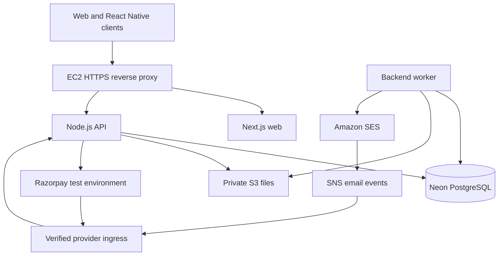

# Invoice SaaS — Brief Architecture
**Version 2.1 · 27 October 2026 · Based on approved PRD v2.1**
Design only; implementation and deployment are not claimed. Supersedes architecture v1.0 where scope differs.

## Agreed baseline — 27 October 2026

- Internal learning/testing MVP using simulated money only. All agreed web, Android and iOS features remain in the MVP; the refund mechanism is explicitly deferred. Delivery may be sequenced, but milestones do not remove agreed scope. Two weeks (~54 hours) is a progress checkpoint, not full-MVP completion acceptance.
- Monthly operating budget ceiling: **INR 5,000** across hosting, database, storage, email, backups and related operating services. Validate estimates before provisioning; no service tier or recovery target is assumed to fit without checking.
- One nonremoved vendor membership per login identity. One Owner/vendor; up to five active and fifteen existing Creators. Current ten-issued-invoices/month quota remains for internal testing; a separately issued replacement consumes quota and cancellation does not restore it.
- Only the related Vendor Owner can reset/replace Creator passwords. Creators have no password-change, initial-password-replacement, recovery, OTP-login or Google-login capability. Email verification remains separate from login.
- Creators retain their agreed own-draft/rework preparation rights. After issue, only the related Vendor Owner may modify an invoice, through a new immutable revision. Preserve original authorship, all prior snapshots/PDFs, payments and receipts. Reducing the collectible amount below allocations releases excess to customer credit; refunds are deferred.
- Sensitive fields requiring Platform Owner approval: legal business name, GSTIN, registered address, login email, contact email/mobile and payment details. Existing approved values stay effective pending approval; verify ownership of a changed email. Routine catalogue, price and tax-default settings remain Vendor Owner managed.
- Vendor Owner may correct customer email through an audited invoice-recipient correction; preserve historical recipient snapshots, revoke prior links/sessions, and send new access to the corrected recorded address. Changing the customer master alone does not silently rewrite issued history.
- Customers may request a fresh invoice link **including after full payment**. Each new link lasts **five days**; email OTP grants a fixed **15-minute session**, subject to earlier link expiry/revocation or eligibility loss. Renewals revoke prior access and are rate-limited/coalesced. Paid invoices remain viewable/downloadable; payment is offered only while outstanding is positive.
- Staff sessions: 24-hour absolute expiry and 30-minute idle timeout; no remember-me initially. OTP/reset-code validity remains five minutes; it is distinct from the customer session duration.
- Both Vendor Owner account recovery and vendor business-data backup/restore are required. Creator recovery remains Owner-controlled. Tenant-safe restore must preserve financial evidence and safely resume jobs without duplicate business effects.
- Still open: GST applicability, inclusive/exclusive pricing, rounding, numbering, backdating/correction policies; backup retention, acceptable data loss (RPO) and recovery time (RTO). These require explicit resolution before affected release/use; no specific values are approved here.

## 1. Architecture at a glance
**TypeScript modular monolith:** one backend codebase, with separate API and worker processes. Deploy on a single AWS EC2 host for the pilot. Database and files remain external to that host.

Next.js, API and worker run as Docker containers on the same EC2 host. No microservices, Redis, Kafka or Kubernetes are needed initially.

## 2. Components and responsibilities

| Component | Choice | Responsibility |
|---|---|---|
| Vendor web / platform admin / customer page | Next.js + React + TypeScript | Role-based screens; Platform Owner is web-only |
| Mobile | React Native, Android + iOS | Vendor Owner and Invoice Creator workflows |
| API | Node.js + TypeScript + Express | Authentication, authorization, business rules and payment orchestration |
| Database | Neon PostgreSQL, Singapore | Tenant data, sessions, invoice/payment records, audit and durable jobs |
| Background worker | Same backend codebase | PDFs, emails, reminders, recurring drafts and reconciliation |
| Files | Private Amazon S3 | Invoice/receipt PDFs, logos and validated QR assets |
| Email | Amazon SES + SNS event notifications | OTPs, business notifications and delivery outcomes |
| Payments | Platform Owner's Razorpay test account | Simulated provider-backed checkout/UPI/QR scenarios; no live vendor money |
| Hosting / deployment | EC2 + Docker Compose + Git CI/CD | Versioned releases; HTTPS; separate secrets and deployment credentials |

**Deployment default:** EC2/S3/SES in Singapore near Neon. Use bounded TLS database pools, private container ports, EC2 IAM roles, managed secrets and structured monitoring. Only the API accesses database/business services; clients never receive backend credentials.

## 3. Backend modules

| Module | Owns |
|---|---|
| Identity and vendors | Signup, onboarding review, Owner/Creator accounts, sessions, sensitive-change approval, block/restore |
| Catalogue and invoices | Customers/products/GST, submission/rework, approval and issuance, quota, document snapshots |
| Collections | Payment attempts, provider events, allocations, credits, disputes and reconciliation; refunds deferred |
| Customer access | Invoice links, OTPs, 15-minute sessions and scoped document/payment access |
| Automation and reporting | Durable jobs, SES, recurrence, reminders, receipts, dashboards and audit |

Modules share PostgreSQL transactions where required. Financial updates and their follow-up jobs commit together. External network calls happen outside database transactions.

## 4. Access and account rules
- One Vendor Owner at signup; Owner manages at most **5 active / 15 existing creators**. Frozen accounts count towards 15; deletion frees a slot. Enforce limits under a vendor-row lock.
- Creators use passwords only; no Google/OTP login or self-service recovery. Only the related Owner sets/resets/replaces passwords and controls freezing/deletion; no Creator initial/self password replacement. Preserve minimal historical authorship where financial records reference deleted creators.
- Owner supports password, email OTP and Google login. Owner/Platform Owner can recover passwords. No public Platform Owner signup or MFA initially; secure sessions, throttling and credential protection still apply.
- Use opaque server-backed sessions: secure HttpOnly web cookies and mobile tokens in OS secure storage. Check role, tenant and current account status on every request.
- Creator sees only their own permitted drafts/submissions and outstanding issued invoices. Owner approves/issues; only the related Owner publishes immutable revisions of issued/paid documents, preserving prior versions and financial history.
- Apply tenant-scoped foreign keys, PostgreSQL row-level security and API object permissions together. Database tenant context is transaction-local.
- Platform Owner approves legal business name, GSTIN, registered address, login/contact email, contact mobile and payment-detail changes. Blocking a vendor revokes access and new payments, sends email and retains history; restore preserves individual creator statuses.

## 5. Main flows
**Invoice:** Creator selects items/quantities → submit locks edits → Owner requests rework, rejects, or approves/issues → transaction assigns number, snapshots values and consumes monthly quota once → worker generates PDF and emails protected link. Owner-created invoices issue directly. Ten issued invoices per vendor per India calendar month; cancellation does not replenish quota.

**Customer:** Five-day invoice link → email OTP → fixed 15-minute invoice session. Customer may request a new five-day link before/after expiry and after payment; send to the current recorded invoice address without Owner approval. Paid invoices support viewing/downloads; payment requires positive outstanding; revoke old access and rate-limit requests. Vendor/invoice eligibility is checked. Private documents stream through authorized endpoints; combined receipts must not expose other invoices.

**Payment:** Backend creates an invoice-bound test payment attempt for full/partial amount → supported provider checkout/QR → verified webhook → deduplicated payment/allocation transaction → balance/receipt update → customer and Owner notified. Frontend callback or QR scan alone never proves payment. Session expiry does not prevent event processing.

**Financial exceptions:** Track pending/failed attempts, advances, excess payments, credits and disputes separately. Refund mechanisms are deferred; Owner revisions that reduce paid debt release excess customer credit without returning funds. Preserve money records, original invoices and corrections. Reconcile late/out-of-order events; never discard excess success or mark a missing event as failure. Payment success and settlement are separate states.

**Automation:** PostgreSQL outbox with leased worker jobs and bounded retries. Recurrence creates Owner drafts only; reminders recheck outstanding balances before dispatch. SES failures remain visible. External email exactly-once delivery is not guaranteed.

## 6. Integrity, operations and delivery boundaries
- Backend idempotency + unique constraints + row locks protect issue/revision/payment/credit actions; frontend disables repeated submissions and reuses request keys.
- Financial amounts use exact decimals; issued snapshots and append-only payment/audit history remain traceable. Mutable tables have server-owned created_at/updated_at; immutable records retain creation/event timestamps.
- Validate provider signatures, account/reference, amount, currency and payment state. Deduplicate both event and payment IDs. Continue valid in-flight confirmations while a vendor is blocked.
- Use a distinct test-mode data/credential boundary. Simulated success is not a real bank transfer. Check supported Razorpay test QR/dispute scenarios; unsupported ones use clearly labelled fixtures. Arbitrary uploaded QR codes cannot provide automatic confirmation.
- Back up vendor business data in PostgreSQL and version private files; rehearse tenant-safe vendor-data restore and safe job resumption. Vendor Owner account recovery is also required; Creator recovery remains Owner-controlled. Monitor host health, failed jobs, email outcomes and payment mismatches. Downtime is acceptable; RPO/RTO and retention still require definition.
- Build through Git CI/CD with database migrations, permission/concurrency tests and smoke checks. All agreed web/Android/iOS workflows and financial scope except refunds are in the MVP; two weeks (~54 hours) is a progress checkpoint. Validate total monthly operations against the INR 5,000 ceiling before provisioning.
- Before live money: provider-approved vendor-account/settlement integration, validated financial/tax policies and production operational checks. No live merchant onboarding, subscriptions, outbound vendor webhooks or automatic recurring debits in this phase.

**Next:** Implement against the updated PRD, database and API contracts; resolve the remaining tax/recovery policies and validate provider capabilities/budget before affected use. Older five-minute sessions, Creator self-replacement and refund-in-MVP contracts are obsolete.

