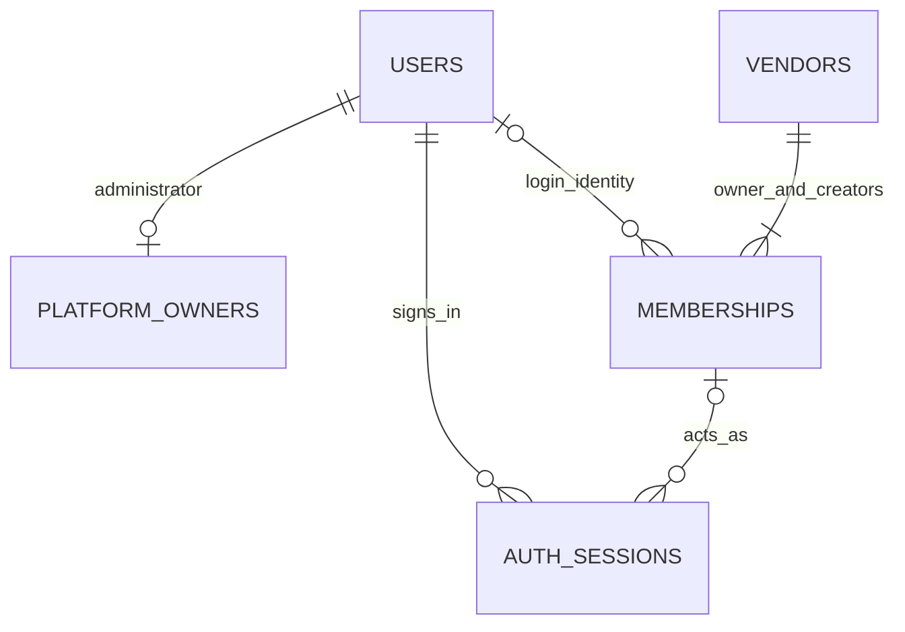
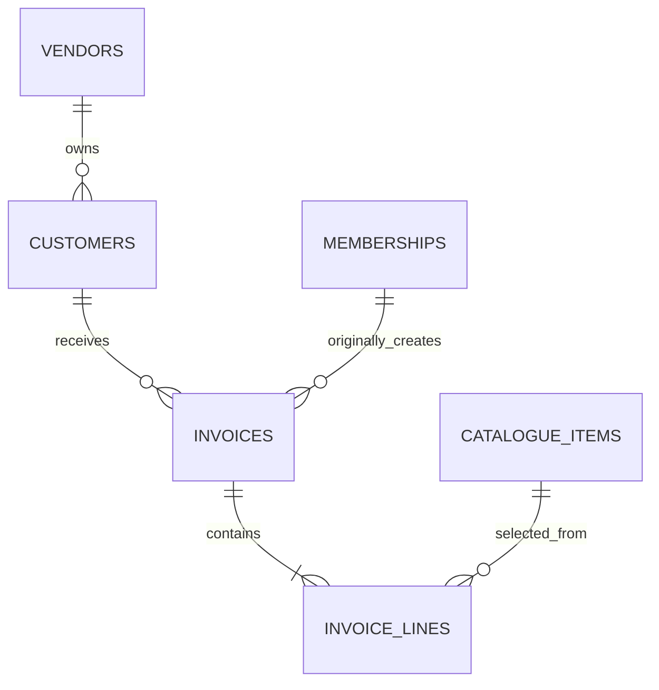
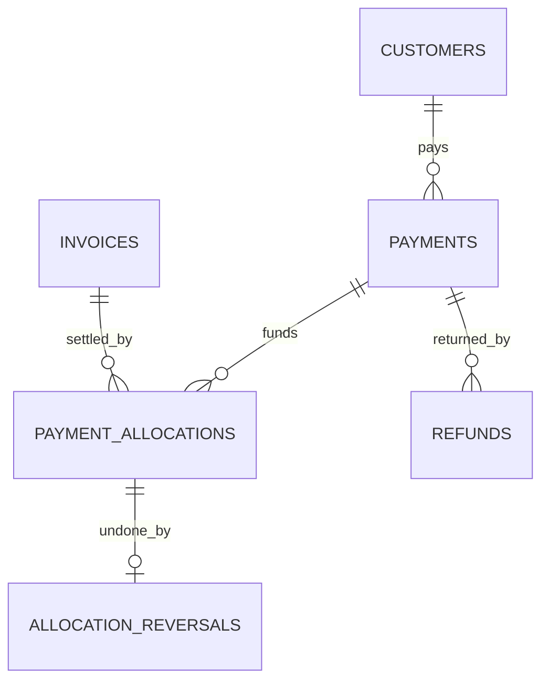
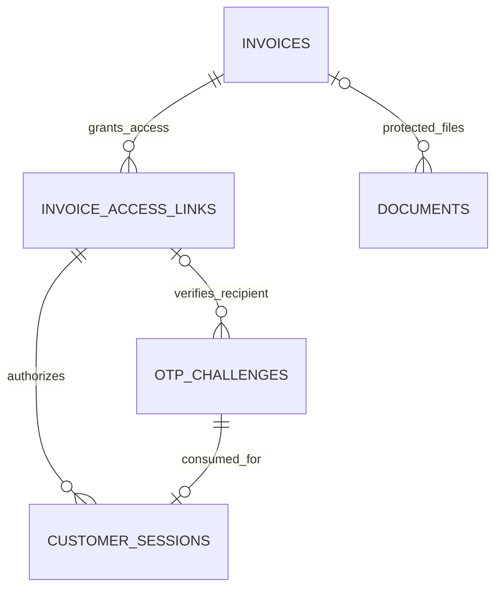
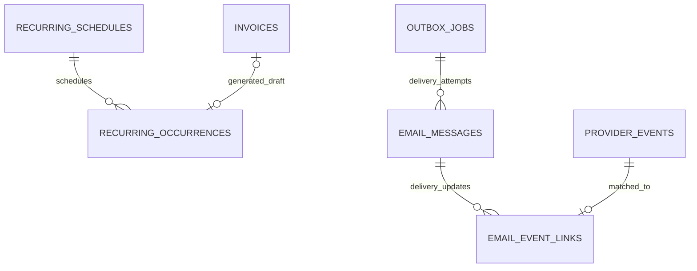

# Invoice SaaS — Database Design v2.1
Design status: implementation blueprint aligned with the latest agreed product decisions. PostgreSQL on Neon; API and worker share this database. This document describes a proposed schema, not deployed migrations. Updated 27 October 2026; source filename remains v2. Refund entities are explicitly reserved for post-MVP and are not required active MVP tables.

## Agreed baseline — 27 October 2026

- Internal learning/testing MVP using simulated money only. All agreed web, Android and iOS features remain in the MVP; the refund mechanism is explicitly deferred. Delivery may be sequenced, but milestones do not remove agreed scope. Two weeks (~54 hours) is a progress checkpoint, not full-MVP completion acceptance.
- Monthly operating budget ceiling: **INR 5,000** across hosting, database, storage, email, backups and related operating services. Validate estimates before provisioning; no service tier or recovery target is assumed to fit without checking.
- One nonremoved vendor membership per login identity. One Owner/vendor; up to five active and fifteen existing Creators. Current ten-issued-invoices/month quota remains for internal testing; a separately issued replacement consumes quota and cancellation does not restore it.
- Only the related Vendor Owner can reset/replace Creator passwords. Creators have no password-change, initial-password-replacement, recovery, OTP-login or Google-login capability. Email verification remains separate from login.
- Creators retain their agreed own-draft/rework preparation rights. After issue, only the related Vendor Owner may modify an invoice, through a new immutable revision. Preserve original authorship, all prior snapshots/PDFs, payments and receipts. Reducing the collectible amount below allocations releases excess to customer credit; refunds are deferred.
- Sensitive fields requiring Platform Owner approval: legal business name, GSTIN, registered address, login email, contact email/mobile and payment details. Existing approved values stay effective pending approval; verify ownership of a changed email. Routine catalogue, price and tax-default settings remain Vendor Owner managed.
- Vendor Owner may correct customer email through an audited invoice-recipient correction; preserve historical recipient snapshots, revoke prior links/sessions, and send new access to the corrected recorded address. Changing the customer master alone does not silently rewrite issued history.
- Customers may request a fresh invoice link **including after full payment**. Each new link lasts **five days**; email OTP grants a fixed **15-minute session**, subject to earlier link expiry/revocation or eligibility loss. Renewals revoke prior access and are rate-limited/coalesced. Paid invoices remain viewable/downloadable; payment is offered only while outstanding is positive.
- Staff sessions: 24-hour absolute expiry and 30-minute idle timeout; no remember-me initially. OTP/reset-code validity remains five minutes; it is distinct from the customer session duration.
- Both Vendor Owner account recovery and vendor business-data backup/restore are required. Creator recovery remains Owner-controlled. Tenant-safe restore must preserve financial evidence and safely resume jobs without duplicate business effects.
- Still open: GST applicability, inclusive/exclusive pricing, rounding, numbering, backdating/correction policies; backup retention, acceptable data loss (RPO) and recovery time (RTO). These require explicit resolution before affected release/use; no specific values are approved here.

## 1. Entities and role terminology
An **entity** is a business concept stored as a table. A **primary key (PK)** uniquely identifies a row; a **foreign key (FK)** connects it to another row. **1:N** means one parent can have many children; **M:N** uses a linking table.

| Term | Representation | Meaning |
|---|---|---|
| Vendor | vendors | Business/tenant that owns all its invoices and customer data. |
| Vendor Owner | users + memberships(role=OWNER) | One owner per vendor; manages creators, customers, products and invoices. |
| Invoice Creator | users + memberships(role=CREATOR) | Password-only staff account with restricted invoice creation rights. |
| Platform Owner | users + platform_owners | Platform administrator who reviews vendor onboarding and sensitive changes. |
| Customer | customers | Vendor's invoice recipient, with no login account. |
| Customer session | customer_sessions | Five-minute access to one invoice after email OTP. |
| Payment | payments | Confirmed money received; distinct from an attempt and from settlement. |
| Allocation | payment_allocations | Links part of a payment to an invoice. |

**Tenant boundary:** a customer's records belong to one vendor. Matching email addresses across vendors do not combine their customers or balances. Platform Owner is not a vendor membership.

## 2. Entity catalogue
Mutable tables have both created_at and updated_at. Append-only tables have created_at only. Issued content is preserved in immutable invoice_revisions and document renditions. Mutable invoice/line rows are latest projections and may change only through guarded Owner revision transactions; other issued financial content permits only documented lifecycle metadata changes.

| # | Entity / table | Area | Purpose | Change policy |
|---|---|---|---|---|
| 1 | [users](#entity-users) | Identity | Login identity for Vendor Owner, Invoice Creator or Platform Owner. | Mutable / lifecycle-controlled |
| 2 | [platform_owners](#entity-platform-owners) | Identity | Privately provisioned platform administrator role. | Mutable / lifecycle-controlled |
| 3 | [auth_identities](#entity-auth-identities) | Identity | Verified Google identity linked to a Vendor Owner. | Append-only |
| 4 | [vendors](#entity-vendors) | Vendor governance | Business tenant; not the human Owner account. | Mutable / lifecycle-controlled |
| 5 | [memberships](#entity-memberships) | Identity | Connects a user to a vendor as Vendor Owner or Invoice Creator. | Mutable / lifecycle-controlled |
| 6 | [auth_sessions](#entity-auth-sessions) | Identity | Server-backed Owner/Creator/Platform Owner login sessions. | Mutable / lifecycle-controlled |
| 7 | [otp_challenges](#entity-otp-challenges) | Access | Purpose-bound email verification codes. | Mutable / lifecycle-controlled |
| 8 | [auth_grants](#entity-auth-grants) | Access | Single-use password-reset or mobile OAuth handoff permission. | Mutable / lifecycle-controlled |
| 9 | [rate_limits](#entity-rate-limits) | Access | Atomic throttling of OTP, login and link-renewal requests. | Mutable / lifecycle-controlled |
| 10 | [vendor_profiles](#entity-vendor-profiles) | Vendor governance | Versioned business and approved payment/contact details. | Mutable / lifecycle-controlled |
| 11 | [change_requests](#entity-change-requests) | Vendor governance | Onboarding and sensitive-change review. | Mutable / lifecycle-controlled |
| 12 | [customers](#entity-customers) | Master data | Owner-maintained invoice recipient and payer, without a login account. | Mutable / lifecycle-controlled |
| 13 | [tax_profiles](#entity-tax-profiles) | Master data | Vendor-maintained tax defaults and calculation configuration. | Mutable / lifecycle-controlled |
| 14 | [catalogue_items](#entity-catalogue-items) | Master data | Products/services selected by Invoice Creator. | Mutable / lifecycle-controlled |
| 15 | [invoices](#entity-invoices) | Invoicing | Invoice header, approval state and preserved issued document. | Mutable / lifecycle-controlled |
| 16 | [invoice_lines](#entity-invoice-lines) | Invoicing | Selected items and exact price/tax snapshots on one invoice. | Mutable / lifecycle-controlled |
| 17 | [invoice_actions](#entity-invoice-actions) | Invoicing | Append-only submission, rework, approval and correction history. | Append-only |
| 18 | [document_sequences](#entity-document-sequences) | Invoicing | Locked numbering counters for invoices, receipts and credit notes. | Mutable / lifecycle-controlled |
| 19 | [monthly_usage](#entity-monthly-usage) | Invoicing | Monthly issuance allowance. | Mutable / lifecycle-controlled |
| 20 | [quota_events](#entity-quota-events) | Invoicing | Evidence of each first issuance counted against quota. | Append-only |
| 21 | [provider_accounts](#entity-provider-accounts) | Payments | Platform test payment account configuration; no merchant onboarding now. | Mutable / lifecycle-controlled |
| 22 | [payment_attempts](#entity-payment-attempts) | Payments | A provider checkout/QR attempt for an invoice or customer advance. | Mutable / lifecycle-controlled |
| 23 | [provider_events](#entity-provider-events) | Payments | Durably received signed provider notifications and processing status. | Mutable / lifecycle-controlled |
| 24 | [payments](#entity-payments) | Payments | Immutable evidence of confirmed funds, including simulation/manual source. | Append-only |
| 25 | [payment_allocations](#entity-payment-allocations) | Payments | Amount of one confirmed payment applied to one invoice. | Append-only |
| 26 | [allocation_reversals](#entity-allocation-reversals) | Payments | Undo a payment-to-invoice mapping without returning money. | Append-only |
| 27 | [payment_reversals](#entity-payment-reversals) | Payments | Correction of a manually recorded payment that was not actually received. | Append-only |
| 28 | [credit_notes](#entity-credit-notes) | Adjustments | Tracked reduction of an issued invoice's collectible amount. | Mutable / lifecycle-controlled |
| 29 | [credit_note_lines](#entity-credit-note-lines) | Adjustments | Line-level explanation/tax snapshot for a credit note. | Mutable / lifecycle-controlled |
| 30 | [refunds — deferred](#entity-refunds) | Deferred post-MVP | Reserved future refund mechanism; no active MVP commands/jobs. | Future mutable / lifecycle-controlled |
| 31 | [disputes](#entity-disputes) | Adjustments | Provider/customer dispute case; separate from invoice paid status. | Mutable / lifecycle-controlled |
| 32 | [dispute_events](#entity-dispute-events) | Adjustments | Immutable dispute status/evidence history. | Append-only |
| 33 | [funds_adjustments](#entity-funds-adjustments) | Adjustments | Confirmed provider debit/credit such as chargeback loss or restoration. | Append-only |
| 34 | [receipts](#entity-receipts) | Payments | Owner-facing receipt for a confirmed payment. | Mutable / lifecycle-controlled |
| 35 | [reconciliation_cases](#entity-reconciliation-cases) | Payments | Unresolved financial exceptions requiring review. | Mutable / lifecycle-controlled |
| 36 | [invoice_access_links](#entity-invoice-access-links) | Customer access | Hashed invoice URL permission to request an OTP, not to read data. | Mutable / lifecycle-controlled |
| 37 | [customer_sessions](#entity-customer-sessions) | Customer access | Five-minute invoice-scoped access after email OTP. | Mutable / lifecycle-controlled |
| 38 | [documents](#entity-documents) | Documents | Private object metadata for invoice, receipt, scoped acknowledgement or upload. | Mutable / lifecycle-controlled |
| 39 | [recurring_schedules](#entity-recurring-schedules) | Automation | Owner's recurring draft-generation rule. | Mutable / lifecycle-controlled |
| 40 | [recurring_occurrences](#entity-recurring-occurrences) | Automation | One scheduled period and its optional resulting draft. | Mutable / lifecycle-controlled |
| 41 | [reminder_rules](#entity-reminder-rules) | Automation | Owner-defined follow-up timing. | Mutable / lifecycle-controlled |
| 42 | [reminder_deliveries](#entity-reminder-deliveries) | Automation | One reminder scheduled for one invoice. | Mutable / lifecycle-controlled |
| 43 | [outbox_jobs](#entity-outbox-jobs) | Operations | Durable side effects committed with business data. | Mutable / lifecycle-controlled |
| 44 | [email_messages](#entity-email-messages) | Operations | Each SES email submission attempt and delivery outcome. | Mutable / lifecycle-controlled |
| 45 | [email_event_links](#entity-email-event-links) | Operations | Links received SES events to matching email attempts. | Append-only |
| 46 | [email_suppressions](#entity-email-suppressions) | Operations | Addresses blocked after hard bounce/complaint. | Mutable / lifecycle-controlled |
| 47 | [idempotency_requests](#entity-idempotency-requests) | Operations | Deduplication for business, admin and bootstrap actions. | Mutable / lifecycle-controlled |
| 48 | [audit_events](#entity-audit-events) | Operations | Append-only human/system action history. | Append-only |
| 49 | [invoice_revisions](#entity-invoice-revisions) | Invoicing | Immutable issued header/line/recipient/tax snapshots and revision deltas. | Append-only |

## 3. Relationship overview
Read a crow's foot as “many.” Diagrams are scoped views; the complete FK register appears later.

### Identity and tenancy

A membership can retain historical authorship after its user account is removed. Each approved vendor has exactly one nonremoved OWNER membership; enforce this in onboarding plus a partial unique index. A vendor has at most five ACTIVE and fifteen ACTIVE-or-FROZEN CREATOR memberships. Platform Owner sessions have no vendor membership.

### Invoice authorship and lines

One issued invoice/revision has at least one line; incomplete drafts may have zero. Original creator membership never changes when the Vendor Owner edits or issues the invoice. Catalogue and customer snapshots preserve what was actually issued. invoice_revisions retains revision 1 and every Owner-published correction, including recipient corrections; invoices holds the latest projection.

### Payments and allocations

Payment-to-invoice is M:N through payment_allocations. An advance has zero allocations initially. A partial payment is an allocation smaller than the invoice balance. The REFUNDS relationship is future post-MVP design only. Allocation reversals only undo bookkeeping; the MVP retains customer credit and does not return funds through a refund mechanism.

### Customer access

An invoice link lasts at most five days. Successful OTP creates a fixed 15-minute session. Each request checks both the session and current link/invoice/vendor eligibility. Receipt access is limited to the authorized invoice, even if its payment covers other invoices.

### Automation and delivery

Recurring occurrences create drafts for owner approval, not automatic debits. Business changes and their jobs commit together; the worker claims and retries jobs.

## 4. Common field and integrity conventions
- Every table has an explicit UUID id primary key and created_at TIMESTAMPTZ NOT NULL DEFAULT now().
- Mutable tables additionally have updated_at TIMESTAMPTZ NOT NULL DEFAULT now(), maintained by a database update trigger. Immutable tables reject UPDATE/DELETE for the runtime role. Lifecycle-controlled records use guarded transition functions/triggers.
- All time instants use UTC TIMESTAMPTZ. Vendor billing months and date-based recurrence use Asia/Kolkata initially. Date-only fields use DATE.
- Monetary totals use NUMERIC(18,2), prices/quantities may use higher precision as listed. Never float. Serialize decimals as strings in APIs. INR is the initial currency.
- TEXT statuses are constrained by CHECK lists. JSONB is for snapshots/provider envelopes/templates, never a replacement for core relationships.
- Nullable means optional; otherwise fields are NOT NULL. Defaults and CHECK expressions must be made explicit in migrations.
- Positive amounts and quantities, nonnegative counters, expiry after issue, and valid date ranges receive CHECK constraints. Cross-row limits require transactions/locks, not CHECK subqueries.
- version is an integer concurrency token where listed; increment atomically on edits. updated_at is not a concurrency token.
- Opaque access/session tokens are stored only as hashes; OTP uses keyed HMAC and a key version. Encrypted values use application encryption with keys outside the database.
- Provider identifiers are TEXT: SES/Razorpay IDs are externally defined strings and need not follow UUID format. Internal row identifiers remain UUID.

### Tenant-safe foreign keys
For every tenant table, add UNIQUE(vendor_id,id). Child references to a tenant parent use (vendor_id,parent_id) → parent(vendor_id,id), in addition to the child's vendor FK. Payments, invoices and allocations also use customer-consistent composite keys, e.g. (vendor_id,customer_id,payment_id) → payments(vendor_id,customer_id,id). Index those referenced tuples as UNIQUE. A plain UUID FK alone does not enforce tenant/customer consistency.

Global/identity tables have no vendor_id where shown. These require narrowly scoped identity/admin/service authorization. RLS uses a transaction-local tenant context set by trusted backend code, never a client-supplied tenant claim. Use a runtime role without BYPASSRLS and explicitly scope worker/admin operations.

## 5. Entity field dictionary
Each table below lists all its columns, including timestamps. FK targets mean target.id unless a composite constraint is specified above. “required, unique” means a unique non-null value; nullable provider identifiers use partial unique indexes when present.

### Entity users
**Table:** `users` — Login identity for Vendor Owner, Invoice Creator or Platform Owner.

| Field | PostgreSQL type | Constraint / relationship | Meaning |
|---|---|---|---|
| id | UUID | PK, required | Internal row identifier. |
| email | TEXT | required, unique | Normalized login email. |
| password_hash | TEXT | nullable | Adaptive password hash; never plaintext. |
| status | TEXT | required | ACTIVE, FROZEN, REMOVED. |
| auth_version | INTEGER | required | Invalidates prior sessions after security changes. |
| email_verified_at | TIMESTAMPTZ | nullable | Email ownership verification time. |
| created_at | TIMESTAMPTZ | required; DEFAULT now() | Row creation time; immutable. |
| updated_at | TIMESTAMPTZ | required; DEFAULT now(); DB trigger | Latest persisted modification time. |

**Rules:** No customer login rows. Creator is password-only; Owner may also use OTP/Google. Recovery is permitted for Owner/Platform Owner, never self-service for Creator.

**Base indexes:** PRIMARY KEY(id). Index child FK columns (tenant-prefixed for tenant parents); reuse an existing composite index when its leading columns already cover the lookup. Additional unique and workload indexes are specified in section 9.

### Entity platform-owners
**Table:** `platform_owners` — Privately provisioned platform administrator role.

| Field | PostgreSQL type | Constraint / relationship | Meaning |
|---|---|---|---|
| id | UUID | PK, required | Internal row identifier. |
| user_id | UUID | required, unique FK users | Platform login identity. |
| status | TEXT | required | ACTIVE or BLOCKED. |
| created_at | TIMESTAMPTZ | required; DEFAULT now() | Row creation time; immutable. |
| updated_at | TIMESTAMPTZ | required; DEFAULT now(); DB trigger | Latest persisted modification time. |

**Rules:** No public creation endpoint. No MFA initially. Role is separate from vendor memberships.

**Base indexes:** PRIMARY KEY(id). Index child FK columns (tenant-prefixed for tenant parents); reuse an existing composite index when its leading columns already cover the lookup. Additional unique and workload indexes are specified in section 9.

### Entity auth-identities
**Table:** `auth_identities` — Verified Google identity linked to a Vendor Owner.

| Field | PostgreSQL type | Constraint / relationship | Meaning |
|---|---|---|---|
| id | UUID | PK, required | Internal row identifier. |
| user_id | UUID | required FK users | Owner login. |
| provider | TEXT | required | GOOGLE. |
| provider_subject | TEXT | required | Provider's opaque user identifier. |
| linked_at | TIMESTAMPTZ | required | Identity linking event. |
| created_at | TIMESTAMPTZ | required; DEFAULT now() | Row creation time; immutable. |

**Rules:** UNIQUE(provider, provider_subject); UNIQUE(user_id,provider). No Google identity for a Creator. Owner status checked on login.

**Base indexes:** PRIMARY KEY(id). Index child FK columns (tenant-prefixed for tenant parents); reuse an existing composite index when its leading columns already cover the lookup. Additional unique and workload indexes are specified in section 9.

### Entity vendors
**Table:** `vendors` — Business tenant; not the human Owner account.

| Field | PostgreSQL type | Constraint / relationship | Meaning |
|---|---|---|---|
| id | UUID | PK, required | Internal row identifier. |
| status | TEXT | required | DRAFT, SUBMITTED, MORE_INFO, APPROVED, REJECTED, BLOCKED. |
| current_profile_id | UUID | nullable FK vendor_profiles | Effective profile of this vendor. |
| timezone | TEXT | required | Asia/Kolkata business calendar. |
| blocked_at | TIMESTAMPTZ | nullable | Reversible soft-deletion time. |
| blocked_from_status | TEXT | nullable | Pre-block lifecycle state restored without implicitly approving a vendor. |
| block_reason | TEXT | nullable | Reason included in notification. |
| version | INTEGER | required | Optimistic concurrency. |
| created_at | TIMESTAMPTZ | required; DEFAULT now() | Row creation time; immutable. |
| updated_at | TIMESTAMPTZ | required; DEFAULT now(); DB trigger | Latest persisted modification time. |

**Rules:** Lock this row when creating/activating/removing Creator memberships. Blocking denies vendor/creator access and new payments, but preserves incoming in-flight financial events.

**Base indexes:** PRIMARY KEY(id). Index child FK columns (tenant-prefixed for tenant parents); reuse an existing composite index when its leading columns already cover the lookup. Additional unique and workload indexes are specified in section 9.

### Entity memberships
**Table:** `memberships` — Connects a user to a vendor as Vendor Owner or Invoice Creator.

| Field | PostgreSQL type | Constraint / relationship | Meaning |
|---|---|---|---|
| id | UUID | PK, required | Internal row identifier. |
| vendor_id | UUID | required FK vendors | Business. |
| user_id | UUID | nullable FK users | Live login; SET NULL on eligible physical identity removal. |
| role | TEXT | required | OWNER or CREATOR. |
| status | TEXT | required | ACTIVE, FROZEN, REMOVED. |
| historical_label | TEXT | required | Minimal author label retained on historical invoices. |
| removed_at | TIMESTAMPTZ | nullable | When account slot was freed. |
| version | INTEGER | required | Concurrency guard. |
| created_at | TIMESTAMPTZ | required; DEFAULT now() | Row creation time; immutable. |
| updated_at | TIMESTAMPTZ | required; DEFAULT now(); DB trigger | Latest persisted modification time. |

**Rules:** One nonremoved OWNER/vendor. Up to 5 ACTIVE CREATOR and 15 nonremoved CREATOR/vendor, checked under vendor lock. Historical REMOVED memberships do not count. Pilot permits one nonremoved vendor membership/user. A nonremoved membership requires a user.

**Base indexes:** PRIMARY KEY(id); UNIQUE(vendor_id,id). Index child FK columns (tenant-prefixed for tenant parents); reuse an existing composite index when its leading columns already cover the lookup. Additional unique and workload indexes are specified in section 9.

### Entity auth-sessions
**Table:** `auth_sessions` — Server-backed Owner/Creator/Platform Owner login sessions.

| Field | PostgreSQL type | Constraint / relationship | Meaning |
|---|---|---|---|
| id | UUID | PK, required | Internal row identifier. |
| user_id | UUID | required FK users | Authenticated identity. |
| membership_id | UUID | nullable FK memberships | Vendor role; null for platform context. |
| token_hash | BYTEA | required, unique | Opaque token digest. |
| auth_version | INTEGER | required | Version at authentication. |
| restricted | BOOLEAN | required | Email-verification-only restriction; no Creator password-change capability. |
| expires_at | TIMESTAMPTZ | required | Server-selected session expiry. |
| revoked_at | TIMESTAMPTZ | nullable | Explicit revocation. |
| last_seen_at | TIMESTAMPTZ | required | Staff idle timeout; initialized at authentication and advanced by valid activity. |
| created_at | TIMESTAMPTZ | required; DEFAULT now() | Row creation time; immutable. |
| updated_at | TIMESTAMPTZ | required; DEFAULT now(); DB trigger | Latest persisted modification time. |

**Rules:** Session membership must belong to user. Enforce role/status on every request and 24-hour absolute/30-minute idle expiry. Enforce last_seen_at atomically; expired sessions cannot be revived. These are not 15-minute customer sessions.

**Base indexes:** PRIMARY KEY(id). Index child FK columns (tenant-prefixed for tenant parents); reuse an existing composite index when its leading columns already cover the lookup. Additional unique and workload indexes are specified in section 9.

### Entity otp-challenges
**Table:** `otp_challenges` — Purpose-bound email verification codes.

| Field | PostgreSQL type | Constraint / relationship | Meaning |
|---|---|---|---|
| id | UUID | PK, required | Internal row identifier. |
| user_id | UUID | nullable FK users | Owner/platform identity or verification subject. |
| access_link_id | UUID | nullable FK invoice_access_links | Customer invoice verification. |
| change_request_id | UUID | nullable FK change_requests | Optional new-email verification binding. |
| purpose | TEXT | required | OWNER_LOGIN, OWNER_RESET, PLATFORM_RESET, EMAIL_VERIFY, CUSTOMER_INVOICE. |
| destination_ciphertext | BYTEA | required | Encrypted exact email receiving code. |
| scope_key | TEXT | required | Server-derived purpose/subject scope. |
| code_hmac | BYTEA | required | Keyed OTP digest. |
| key_version | INTEGER | required | HMAC/encryption-key version. |
| generation | INTEGER | required | Resend generation. |
| attempts | INTEGER | required | Failed attempts; initial maximum five. |
| expires_at | TIMESTAMPTZ | required | Initial validity five minutes. |
| consumed_at | TIMESTAMPTZ | nullable | Successful use. |
| invalidated_at | TIMESTAMPTZ | nullable | Superseded/revoked code. |
| created_at | TIMESTAMPTZ | required; DEFAULT now() | Row creation time; immutable. |
| updated_at | TIMESTAMPTZ | required; DEFAULT now(); DB trigger | Latest persisted modification time. |

**Rules:** CHECK subject shape by purpose; Creator cannot use login/reset purposes. One active unconsumed/uninvalidated challenge/scope via partial unique index; invalidate expired predecessor on resend. Commit failed attempts.

**Base indexes:** PRIMARY KEY(id). Index child FK columns (tenant-prefixed for tenant parents); reuse an existing composite index when its leading columns already cover the lookup. Additional unique and workload indexes are specified in section 9.

### Entity auth-grants
**Table:** `auth_grants` — Single-use password-reset or mobile OAuth handoff permission.

| Field | PostgreSQL type | Constraint / relationship | Meaning |
|---|---|---|---|
| id | UUID | PK, required | Internal row identifier. |
| user_id | UUID | nullable FK users | Required for reset/handoff; OAuth signup state may precede identity creation. |
| purpose | TEXT | required | PASSWORD_RESET, OAUTH_HANDOFF or OAUTH_STATE. |
| metadata_ciphertext | BYTEA | nullable | Short-lived OAuth state/nonce/PKCE/redirect binding; no plaintext secrets. |
| key_version | INTEGER | nullable | Required when OAuth metadata is encrypted. |
| token_hash | BYTEA | required, unique | Grant digest. |
| pkce_challenge | TEXT | nullable | Mobile handoff proof. |
| expires_at | TIMESTAMPTZ | required | Short configured validity. |
| consumed_at | TIMESTAMPTZ | nullable | Single-use consumption. |
| created_at | TIMESTAMPTZ | required; DEFAULT now() | Row creation time; immutable. |
| updated_at | TIMESTAMPTZ | required; DEFAULT now(); DB trigger | Latest persisted modification time. |

**Rules:** Reset purpose restricted to Vendor Owner/Platform Owner. OAUTH_STATE is distinct from handoff, binds nonce/PKCE/allowlisted redirect and is consumed once; apply purpose-specific subject/metadata CHECKs. Grant is not an application login session.

**Base indexes:** PRIMARY KEY(id). Index child FK columns (tenant-prefixed for tenant parents); reuse an existing composite index when its leading columns already cover the lookup. Additional unique and workload indexes are specified in section 9.

### Entity rate-limits
**Table:** `rate_limits` — Atomic throttling of OTP, login and link-renewal requests.

| Field | PostgreSQL type | Constraint / relationship | Meaning |
|---|---|---|---|
| id | UUID | PK, required | Internal row identifier. |
| scope_hash | BYTEA | required | Keyed email/account/IP digest. |
| action | TEXT | required | Limited operation. |
| window_start | TIMESTAMPTZ | required | Counter period. |
| counter | INTEGER | required | Atomic request count. |
| expires_at | TIMESTAMPTZ | required | Cleanup deadline. |
| created_at | TIMESTAMPTZ | required; DEFAULT now() | Row creation time; immutable. |
| updated_at | TIMESTAMPTZ | required; DEFAULT now(); DB trigger | Latest persisted modification time. |

**Rules:** UNIQUE(scope_hash,action,window_start). No plaintext IP/email required for lookup.

**Base indexes:** PRIMARY KEY(id). Index child FK columns (tenant-prefixed for tenant parents); reuse an existing composite index when its leading columns already cover the lookup. Additional unique and workload indexes are specified in section 9.

### Entity vendor-profiles
**Table:** `vendor_profiles` — Versioned business and approved payment/contact details.

| Field | PostgreSQL type | Constraint / relationship | Meaning |
|---|---|---|---|
| id | UUID | PK, required | Internal row identifier. |
| vendor_id | UUID | required FK vendors | Business. |
| version_no | INTEGER | required | Profile version. |
| business_name | TEXT | required | Invoice issuer name. |
| address | JSONB | required | Validated structured address. |
| contact_email | TEXT | required | Approved business contact. |
| contact_mobile | TEXT | nullable | Approved mobile. |
| gstin | TEXT | nullable | Vendor tax identity. |
| default_tax_profile_id | UUID | nullable FK tax_profiles | Fallback tax settings. |
| payment_details_ciphertext | BYTEA | nullable | Encrypted bank/UPI details. |
| key_version | INTEGER | nullable | Encryption-key version. |
| qr_document_id | UUID | nullable FK documents | Optional private vendor QR. |
| approved_at | TIMESTAMPTZ | nullable | Version approval/effectiveness. |
| version | INTEGER | required | Concurrency while editable. |
| created_at | TIMESTAMPTZ | required; DEFAULT now() | Row creation time; immutable. |
| updated_at | TIMESTAMPTZ | required; DEFAULT now(); DB trigger | Latest persisted modification time. |

**Rules:** UNIQUE(vendor_id,version_no). Approved content immutable. Uploaded QR is supplementary and does not generate automatic payment confirmations.

**Base indexes:** PRIMARY KEY(id); UNIQUE(vendor_id,id). Index child FK columns (tenant-prefixed for tenant parents); reuse an existing composite index when its leading columns already cover the lookup. Additional unique and workload indexes are specified in section 9.

### Entity change-requests
**Table:** `change_requests` — Onboarding and sensitive-change review.

| Field | PostgreSQL type | Constraint / relationship | Meaning |
|---|---|---|---|
| id | UUID | PK, required | Internal row identifier. |
| vendor_id | UUID | required FK vendors | Business. |
| kind | TEXT | required | ONBOARDING or SENSITIVE_PROFILE. |
| target | TEXT | required | ONBOARDING, LOGIN_EMAIL, CONTACT_EMAIL, CONTACT_MOBILE, PAYMENT_DETAILS or BUSINESS_IDENTITY. |
| proposed_identity_email_ciphertext | BYTEA | nullable | Proposed login email only; separate from profile contact_email. |
| key_version | INTEGER | nullable | Required for encrypted proposed identity email. |
| base_profile_id | UUID | nullable FK vendor_profiles | Version being replaced. |
| proposed_profile_id | UUID | nullable FK vendor_profiles | Required for onboarding/profile changes; login-email-only change may omit. |
| status | TEXT | required | SUBMITTED, MORE_INFO, APPROVED, REJECTED. |
| requested_by_membership_id | UUID | required FK memberships | Owner who requested. |
| reviewed_by_id | UUID | nullable FK platform_owners | Platform reviewer. |
| reason | TEXT | nullable | Decision/information request. |
| reviewed_at | TIMESTAMPTZ | nullable | Review event. |
| version | INTEGER | required | Concurrency. |
| created_at | TIMESTAMPTZ | required; DEFAULT now() | Row creation time; immutable. |
| updated_at | TIMESTAMPTZ | required; DEFAULT now(); DB trigger | Latest persisted modification time. |

**Rules:** Tenant FKs on profiles/membership. Approval checks target shape, base version and new-email verification; BUSINESS_IDENTITY covers legal business name, GSTIN and registered address. LOGIN_EMAIL verifies and atomically updates users.email separately from contact_email; old approved values remain active pending review.

**Base indexes:** PRIMARY KEY(id); UNIQUE(vendor_id,id). Index child FK columns (tenant-prefixed for tenant parents); reuse an existing composite index when its leading columns already cover the lookup. Additional unique and workload indexes are specified in section 9.

### Entity customers
**Table:** `customers` — Owner-maintained invoice recipient and payer, without a login account.

| Field | PostgreSQL type | Constraint / relationship | Meaning |
|---|---|---|---|
| id | UUID | PK, required | Internal row identifier. |
| vendor_id | UUID | required FK vendors | Business owning record. |
| name | TEXT | required | Customer display name. |
| email | TEXT | required | Invoice and OTP recipient. |
| phone | TEXT | nullable | Contact. |
| address | JSONB | required | Billing address. |
| gstin | TEXT | nullable | Tax identity. |
| status | TEXT | required | ACTIVE or ARCHIVED. |
| version | INTEGER | required | Concurrency. |
| created_at | TIMESTAMPTZ | required; DEFAULT now() | Row creation time; immutable. |
| updated_at | TIMESTAMPTZ | required; DEFAULT now(); DB trigger | Latest persisted modification time. |

**Rules:** No unique global email; never combine separate customers solely by email. Lock customer row before financial mutations.

**Base indexes:** PRIMARY KEY(id); UNIQUE(vendor_id,id). Index child FK columns (tenant-prefixed for tenant parents); reuse an existing composite index when its leading columns already cover the lookup. Additional unique and workload indexes are specified in section 9.

### Entity tax-profiles
**Table:** `tax_profiles` — Vendor-maintained tax defaults and calculation configuration.

| Field | PostgreSQL type | Constraint / relationship | Meaning |
|---|---|---|---|
| id | UUID | PK, required | Internal row identifier. |
| vendor_id | UUID | required FK vendors | Business. |
| name | TEXT | required | Configuration label. |
| mode | TEXT | required | GST or NONE. |
| components | JSONB | required | Validated rates and component settings. |
| calculation_version | TEXT | required | Versioned rule identifier. |
| active | BOOLEAN | required | Selectable status. |
| version | INTEGER | required | Concurrency. |
| created_at | TIMESTAMPTZ | required; DEFAULT now() | Row creation time; immutable. |
| updated_at | TIMESTAMPTZ | required; DEFAULT now(); DB trigger | Latest persisted modification time. |

**Rules:** Vendor supplies values; applicability/rounding requires validation. JSON schema enforced by application; no hidden statutory assumptions.

**Base indexes:** PRIMARY KEY(id); UNIQUE(vendor_id,id). Index child FK columns (tenant-prefixed for tenant parents); reuse an existing composite index when its leading columns already cover the lookup. Additional unique and workload indexes are specified in section 9.

### Entity catalogue-items
**Table:** `catalogue_items` — Products/services selected by Invoice Creator.

| Field | PostgreSQL type | Constraint / relationship | Meaning |
|---|---|---|---|
| id | UUID | PK, required | Internal row identifier. |
| vendor_id | UUID | required FK vendors | Business. |
| sku | TEXT | nullable | Vendor item code. |
| name | TEXT | required | Product/service. |
| item_type | TEXT | required | PRODUCT or SERVICE. |
| unit | TEXT | required | Quantity unit. |
| unit_price | NUMERIC(18,6) | required | Owner-defined price. |
| tax_profile_id | UUID | nullable FK tax_profiles | Item-level default. |
| hsn_sac | TEXT | nullable | Classification. |
| active | BOOLEAN | required | Selectable status. |
| version | INTEGER | required | Catalogue version. |
| created_at | TIMESTAMPTZ | required; DEFAULT now() | Row creation time; immutable. |
| updated_at | TIMESTAMPTZ | required; DEFAULT now(); DB trigger | Latest persisted modification time. |

**Rules:** UNIQUE(vendor_id,sku) when supplied. Price >= 0. Owner-only writes. Issued invoice lines retain snapshots.

**Base indexes:** PRIMARY KEY(id); UNIQUE(vendor_id,id). Index child FK columns (tenant-prefixed for tenant parents); reuse an existing composite index when its leading columns already cover the lookup. Additional unique and workload indexes are specified in section 9.

### Entity invoices
**Table:** `invoices` — Invoice header, approval state and preserved issued document.

| Field | PostgreSQL type | Constraint / relationship | Meaning |
|---|---|---|---|
| id | UUID | PK, required | Internal row identifier. |
| vendor_id | UUID | required FK vendors | Business. |
| customer_id | UUID | required FK customers | Invoice recipient. |
| created_by_membership_id | UUID | required FK memberships | Original Owner or Creator author. |
| origin | TEXT | required | OWNER, CREATOR, RECURRING. |
| approval_state | TEXT | required | DRAFT, SUBMITTED, REWORK, APPROVED, REJECTED. |
| document_state | TEXT | required | UNISSUED, ISSUED, CANCELLED, SUPERSEDED. |
| current_revision_no | INTEGER | required | Zero before issue; latest immutable invoice revision after issue. |
| invoice_number | TEXT | nullable | Unique vendor invoice reference after issue. |
| invoice_date | DATE | required | Business date. |
| due_date | DATE | nullable | Collection due date. |
| currency | CHAR(3) | required | INR. |
| subtotal | NUMERIC(18,2) | required | Before discount/tax. |
| discount_total | NUMERIC(18,2) | required | Discount. |
| tax_total | NUMERIC(18,2) | required | Tax. |
| rounding_adjustment | NUMERIC(18,2) | required | Signed explicit adjustment. |
| total | NUMERIC(18,2) | required | Posted invoice amount. |
| seller_snapshot | JSONB | nullable | Frozen issuer details. |
| customer_snapshot | JSONB | nullable | Frozen recipient details. |
| tax_snapshot | JSONB | nullable | Frozen calculation details. |
| profile_id | UUID | nullable FK vendor_profiles | Payment/business profile used. |
| replaces_invoice_id | UUID | nullable FK invoices | Original document for tracked replacement. |
| submitted_at | TIMESTAMPTZ | nullable | Last submission. |
| issued_at | TIMESTAMPTZ | nullable | Issuance event. |
| cancelled_at | TIMESTAMPTZ | nullable | Cancellation event. |
| reminders_paused | BOOLEAN | required | Owner preference. |
| version | INTEGER | required | Concurrency. |
| created_at | TIMESTAMPTZ | required; DEFAULT now() | Row creation time; immutable. |
| updated_at | TIMESTAMPTZ | required; DEFAULT now(); DB trigger | Latest persisted modification time. |

**Rules:** Same vendor/customer FKs; original authorship unchanged by Owner approval. Issued rows require number/snapshots. total=subtotal-discount_total+tax_total+rounding_adjustment. No writable paid flag. No direct overwrite of issued history: only the related Owner may publish an immutable invoice_revisions row and atomically update the latest header/line projection. Preserve prior PDFs, original author and payment history. Replacements never delete original.

**Base indexes:** PRIMARY KEY(id); UNIQUE(vendor_id,id). Index child FK columns (tenant-prefixed for tenant parents); reuse an existing composite index when its leading columns already cover the lookup. Additional unique and workload indexes are specified in section 9.

### Entity invoice-lines
**Table:** `invoice_lines` — Selected items and exact price/tax snapshots on one invoice.

| Field | PostgreSQL type | Constraint / relationship | Meaning |
|---|---|---|---|
| id | UUID | PK, required | Internal row identifier. |
| vendor_id | UUID | required FK vendors | Tenant. |
| invoice_id | UUID | required FK invoices | Parent. |
| catalogue_item_id | UUID | required FK catalogue_items | Source item. |
| line_no | INTEGER | required | Display order. |
| catalogue_version | INTEGER | required | Source revision. |
| description | TEXT | required | Snapshot. |
| unit | TEXT | required | Snapshot. |
| quantity | NUMERIC(18,6) | required | Creator/Owner input. |
| unit_price | NUMERIC(18,6) | required | Snapshot; Creator cannot override. |
| discount_amount | NUMERIC(18,2) | required | Owner-authorized discount. |
| tax_components | JSONB | required | Snapshot. |
| taxable_amount | NUMERIC(18,2) | required | Tax basis. |
| tax_amount | NUMERIC(18,2) | required | Posted tax. |
| line_total | NUMERIC(18,2) | required | Taxable amount plus tax. |
| created_at | TIMESTAMPTZ | required; DEFAULT now() | Row creation time; immutable. |
| updated_at | TIMESTAMPTZ | required; DEFAULT now(); DB trigger | Latest persisted modification time. |

**Rules:** UNIQUE(vendor_id,invoice_id,line_no). Positive quantity. Parent invoice lock serializes edits and issuance. Reject direct line changes after issuance; a guarded Owner revision transaction may update the current projection only after appending complete immutable prior/new snapshots.

**Base indexes:** PRIMARY KEY(id); UNIQUE(vendor_id,id). Index child FK columns (tenant-prefixed for tenant parents); reuse an existing composite index when its leading columns already cover the lookup. Additional unique and workload indexes are specified in section 9.

### Entity invoice-revisions
**Table:** `invoice_revisions` — Complete immutable issued snapshots; revision 1 is the original invoice.

| Field | PostgreSQL type | Constraint / relationship | Meaning |
|---|---|---|---|
| id | UUID | PK, required | Revision identifier. |
| vendor_id | UUID | required FK vendors | Tenant. |
| invoice_id | UUID | required FK invoices | Same invoice across revisions. |
| revision_no | INTEGER | required, positive | UNIQUE(vendor_id,invoice_id,revision_no). |
| previous_revision_id | UUID | nullable FK invoice_revisions | Null for revision 1; same invoice/vendor predecessor otherwise. |
| actor_membership_id | UUID | required FK memberships | Related Owner publishing issue/correction. |
| reason | TEXT | required | Initial issue, modification or recipient correction. |
| header_snapshot | JSONB | required | Complete issued header, seller, recipient, dates, taxes and calculation version. |
| lines_snapshot | JSONB | required | Complete validated line snapshots; never only a diff. |
| total | NUMERIC(18,2) | required, nonnegative | Revised invoice total. |
| signed_total_delta | NUMERIC(18,2) | required | Zero for revision 1; new total minus predecessor total thereafter. |
| created_at | TIMESTAMPTZ | required; DEFAULT now() | Publication event. |

**Rules:** Tenant-safe invoice/predecessor/actor FKs, unique predecessor successor, contiguous revision numbers under invoice lock, and no update/delete by runtime. The actor must be the related Owner. Preserve original author. Reject unresolved payment attempts before financial revisions. Keep invoice customer identity fixed pending the detailed tax/correction policy. Negative deltas require linked credit notes and atomic release of excess allocations to customer credit; no refunds. A recipient-only correction has zero delta and revokes old access/challenges before re-delivery. Same-invoice revisions retain invoice number and consume no extra quota; separately issued replacements consume quota. Financial caps must include existing standalone credits.

**Indexes:** UNIQUE(vendor_id,id); UNIQUE(vendor_id,invoice_id,revision_no); UNIQUE(previous_revision_id) where present; index(vendor_id,invoice_id,created_at).

### Entity invoice-actions
**Table:** `invoice_actions` — Append-only submission, rework, approval and correction history.

| Field | PostgreSQL type | Constraint / relationship | Meaning |
|---|---|---|---|
| id | UUID | PK, required | Internal row identifier. |
| vendor_id | UUID | required FK vendors | Tenant. |
| invoice_id | UUID | required FK invoices | Document. |
| actor_membership_id | UUID | required FK memberships | Owner/Creator historical actor. |
| action | TEXT | required | SUBMIT, REQUEST_CHANGES, RESUBMIT, APPROVE_AND_ISSUE, REJECT, CANCEL, REPLACE, SUPERSEDE, REVISE, RECIPIENT_EMAIL_CORRECT. |
| reason | TEXT | nullable | Required for rework/rejection/correction. |
| invoice_version | INTEGER | required | Revision acted on. |
| created_at | TIMESTAMPTZ | required; DEFAULT now() | Row creation time; immutable. |

**Rules:** Author and approver are distinct. Complete rejection removes Creator access but preserves action history.

**Base indexes:** PRIMARY KEY(id); UNIQUE(vendor_id,id). Index child FK columns (tenant-prefixed for tenant parents); reuse an existing composite index when its leading columns already cover the lookup. Additional unique and workload indexes are specified in section 9.

### Entity document-sequences
**Table:** `document_sequences` — Locked numbering counters for invoices, receipts and credit notes.

| Field | PostgreSQL type | Constraint / relationship | Meaning |
|---|---|---|---|
| id | UUID | PK, required | Internal row identifier. |
| vendor_id | UUID | required FK vendors | Tenant. |
| kind | TEXT | required | INVOICE, RECEIPT, CREDIT_NOTE. |
| series | TEXT | required | Configured numbering period/prefix. |
| next_value | BIGINT | required | Next positive counter. |
| created_at | TIMESTAMPTZ | required; DEFAULT now() | Row creation time; immutable. |
| updated_at | TIMESTAMPTZ | required; DEFAULT now(); DB trigger | Latest persisted modification time. |

**Rules:** UNIQUE(vendor_id,kind,series); allocate in transaction, never MAX+1.

**Base indexes:** PRIMARY KEY(id); UNIQUE(vendor_id,id). Index child FK columns (tenant-prefixed for tenant parents); reuse an existing composite index when its leading columns already cover the lookup. Additional unique and workload indexes are specified in section 9.

### Entity monthly-usage
**Table:** `monthly_usage` — Monthly issuance allowance.

| Field | PostgreSQL type | Constraint / relationship | Meaning |
|---|---|---|---|
| id | UUID | PK, required | Internal row identifier. |
| vendor_id | UUID | required FK vendors | Tenant. |
| month_start | DATE | required | India calendar month. |
| issued_count | INTEGER | required | Issued invoice count. |
| invoice_limit | INTEGER | required | Initially 10. |
| created_at | TIMESTAMPTZ | required; DEFAULT now() | Row creation time; immutable. |
| updated_at | TIMESTAMPTZ | required; DEFAULT now(); DB trigger | Latest persisted modification time. |

**Rules:** UNIQUE(vendor_id,month_start). Conditional increment under lock; cancellation does not restore quota.

**Base indexes:** PRIMARY KEY(id); UNIQUE(vendor_id,id). Index child FK columns (tenant-prefixed for tenant parents); reuse an existing composite index when its leading columns already cover the lookup. Additional unique and workload indexes are specified in section 9.

### Entity quota-events
**Table:** `quota_events` — Evidence of each first issuance counted against quota.

| Field | PostgreSQL type | Constraint / relationship | Meaning |
|---|---|---|---|
| id | UUID | PK, required | Internal row identifier. |
| vendor_id | UUID | required FK vendors | Tenant. |
| invoice_id | UUID | required FK invoices | Counted invoice. |
| usage_id | UUID | required FK monthly_usage | Month bucket. |
| created_at | TIMESTAMPTZ | required; DEFAULT now() | Row creation time; immutable. |

**Rules:** UNIQUE(vendor_id,invoice_id). Reconcile counters against events.

**Base indexes:** PRIMARY KEY(id); UNIQUE(vendor_id,id). Index child FK columns (tenant-prefixed for tenant parents); reuse an existing composite index when its leading columns already cover the lookup. Additional unique and workload indexes are specified in section 9.

### Entity provider-accounts
**Table:** `provider_accounts` — Platform test payment account configuration; no merchant onboarding now.

| Field | PostgreSQL type | Constraint / relationship | Meaning |
|---|---|---|---|
| id | UUID | PK, required | Internal row identifier. |
| provider | TEXT | required | RAZORPAY. |
| mode | TEXT | required | TEST; no live activation in this version. |
| external_account_id | TEXT | required | Opaque provider identifier. |
| secret_reference | TEXT | required | Secret-manager reference, never credentials. |
| enabled | BOOLEAN | required | Integration availability. |
| created_at | TIMESTAMPTZ | required; DEFAULT now() | Row creation time; immutable. |
| updated_at | TIMESTAMPTZ | required; DEFAULT now(); DB trigger | Latest persisted modification time. |

**Rules:** Global configuration: one platform test account may serve many simulated vendors. No implied live authorization to collect their money.

**Base indexes:** PRIMARY KEY(id). Index child FK columns (tenant-prefixed for tenant parents); reuse an existing composite index when its leading columns already cover the lookup. Additional unique and workload indexes are specified in section 9.

### Entity payment-attempts
**Table:** `payment_attempts` — A provider checkout/QR attempt for an invoice or customer advance.

| Field | PostgreSQL type | Constraint / relationship | Meaning |
|---|---|---|---|
| id | UUID | PK, required | Internal row identifier. |
| vendor_id | UUID | required FK vendors | Tenant. |
| customer_id | UUID | required FK customers | Payer. |
| invoice_id | UUID | nullable FK invoices | Null for an explicitly supported advance. |
| provider_account_id | UUID | required FK provider_accounts | Test account. |
| purpose | TEXT | required | INVOICE or ADVANCE. |
| requested_amount | NUMERIC(18,2) | required | Exact amount requested. |
| currency | CHAR(3) | required | INR. |
| method | TEXT | required | CHECKOUT_UPI or PROVIDER_QR. |
| external_order_id | TEXT | nullable | Opaque provider order. |
| external_qr_id | TEXT | nullable | Opaque provider QR. |
| status | TEXT | required | CREATING, PENDING, SUCCEEDED, FAILED, EXPIRED, UNKNOWN. |
| expires_at | TIMESTAMPTZ | nullable | Attempt expiry. |
| idempotency_key | TEXT | required | Create-attempt dedupe. |
| version | INTEGER | required | Concurrency. |
| created_at | TIMESTAMPTZ | required; DEFAULT now() | Row creation time; immutable. |
| updated_at | TIMESTAMPTZ | required; DEFAULT now(); DB trigger | Latest persisted modification time. |

**Rules:** Invoice and customer must match. Client cannot choose merchant/price freely. Unique provider identifiers scoped by account when present. An attempt may receive multiple actual payment records; never drop a late extra success.

**Base indexes:** PRIMARY KEY(id); UNIQUE(vendor_id,id). Index child FK columns (tenant-prefixed for tenant parents); reuse an existing composite index when its leading columns already cover the lookup. Additional unique and workload indexes are specified in section 9.

### Entity provider-events
**Table:** `provider_events` — Durably received signed provider notifications and processing status.

| Field | PostgreSQL type | Constraint / relationship | Meaning |
|---|---|---|---|
| id | UUID | PK, required | Internal row identifier. |
| provider | TEXT | required | RAZORPAY or SES. |
| provider_account_id | UUID | nullable FK provider_accounts | Payment account; null for SES. |
| external_event_id | TEXT | required | Provider event or stable dedupe identifier. |
| dedupe_key | TEXT | required, unique | Provider/account/event composite key. |
| event_type | TEXT | required | Provider event name. |
| payload_ciphertext | BYTEA | required | Minimal encrypted provider evidence. |
| key_version | INTEGER | required | Encryption key. |
| received_at | TIMESTAMPTZ | required | Ingress time. |
| processed_at | TIMESTAMPTZ | nullable | Handler completion. |
| status | TEXT | required | RECEIVED, PROCESSED, UNMATCHED, FAILED. |
| error_code | TEXT | nullable | Redacted processing failure. |
| created_at | TIMESTAMPTZ | required; DEFAULT now() | Row creation time; immutable. |
| updated_at | TIMESTAMPTZ | required; DEFAULT now(); DB trigger | Latest persisted modification time. |

**Rules:** External IDs are TEXT. Global ingress cannot trust an unverified vendorId in payload. Map verified account/order/payment to internal attempt. Raw payload immutable; processing metadata mutable.

**Base indexes:** PRIMARY KEY(id). Index child FK columns (tenant-prefixed for tenant parents); reuse an existing composite index when its leading columns already cover the lookup. Additional unique and workload indexes are specified in section 9.

### Entity payments
**Table:** `payments` — Immutable evidence of confirmed funds, including simulation/manual source.

| Field | PostgreSQL type | Constraint / relationship | Meaning |
|---|---|---|---|
| id | UUID | PK, required | Internal row identifier. |
| vendor_id | UUID | required FK vendors | Tenant. |
| customer_id | UUID | required FK customers | Payer. |
| attempt_id | UUID | nullable FK payment_attempts | Provider attempt; null for manual. |
| provider_account_id | UUID | nullable FK provider_accounts | Source account. |
| external_payment_id | TEXT | nullable | Provider payment ID. |
| source | TEXT | required | PROVIDER_TEST, FIXTURE, MANUAL_TEST. |
| method | TEXT | required | UPI, BANK, CASH, OTHER. |
| amount | NUMERIC(18,2) | required | Confirmed gross amount. |
| currency | CHAR(3) | required | INR. |
| received_at | TIMESTAMPTZ | required | Provider/Owner-confirmed receipt time. |
| recorded_by_membership_id | UUID | nullable FK memberships | Required for manual recording. |
| reference | TEXT | nullable | External transaction reference. |
| verified_event_id | UUID | nullable FK provider_events | Evidence for provider confirmation. |
| created_at | TIMESTAMPTZ | required; DEFAULT now() | Row creation time; immutable. |

**Rules:** UNIQUE(provider_account_id,external_payment_id) when present; all amounts positive. Failed attempts do not create payments. Fixture evidence never masquerades as provider-verified money.

**Base indexes:** PRIMARY KEY(id); UNIQUE(vendor_id,id). Index child FK columns (tenant-prefixed for tenant parents); reuse an existing composite index when its leading columns already cover the lookup. Additional unique and workload indexes are specified in section 9.

### Entity payment-allocations
**Table:** `payment_allocations` — Amount of one confirmed payment applied to one invoice.

| Field | PostgreSQL type | Constraint / relationship | Meaning |
|---|---|---|---|
| id | UUID | PK, required | Internal row identifier. |
| vendor_id | UUID | required FK vendors | Tenant. |
| customer_id | UUID | required FK customers | Shared payer. |
| payment_id | UUID | required FK payments | Funds source. |
| invoice_id | UUID | required FK invoices | Debt being settled. |
| amount | NUMERIC(18,2) | required | Positive allocated amount. |
| actor_membership_id | UUID | nullable FK memberships | Owner; null for system allocation. |
| created_at | TIMESTAMPTZ | required; DEFAULT now() | Row creation time; immutable. |

**Rules:** Composite vendor/customer FKs to both parent records. Sum caps enforced under locks. One payment can cover many invoices; invoice can receive many payments.

**Base indexes:** PRIMARY KEY(id); UNIQUE(vendor_id,id). Index child FK columns (tenant-prefixed for tenant parents); reuse an existing composite index when its leading columns already cover the lookup. Additional unique and workload indexes are specified in section 9.

### Entity allocation-reversals
**Table:** `allocation_reversals` — Undo a payment-to-invoice mapping without returning money.

| Field | PostgreSQL type | Constraint / relationship | Meaning |
|---|---|---|---|
| id | UUID | PK, required | Internal row identifier. |
| vendor_id | UUID | required FK vendors | Tenant. |
| allocation_id | UUID | required, unique FK payment_allocations | Allocation being fully undone. |
| amount | NUMERIC(18,2) | required | Must equal original allocation. |
| reason | TEXT | required | Correction/credit/refund context. |
| actor_membership_id | UUID | nullable FK memberships | Owner or system trace via audit. |
| created_at | TIMESTAMPTZ | required; DEFAULT now() | Row creation time; immutable. |

**Rules:** Full reversal per allocation. For partial correction reverse original and insert smaller replacement allocations in the same transaction.

**Base indexes:** PRIMARY KEY(id); UNIQUE(vendor_id,id). Index child FK columns (tenant-prefixed for tenant parents); reuse an existing composite index when its leading columns already cover the lookup. Additional unique and workload indexes are specified in section 9.

### Entity payment-reversals
**Table:** `payment_reversals` — Correction of a manually recorded payment that was not actually received.

| Field | PostgreSQL type | Constraint / relationship | Meaning |
|---|---|---|---|
| id | UUID | PK, required | Internal row identifier. |
| vendor_id | UUID | required FK vendors | Tenant. |
| payment_id | UUID | required, unique FK payments | Erroneous receipt. |
| actor_membership_id | UUID | required FK memberships | Owner. |
| reason | TEXT | required | Why manual entry was invalid. |
| created_at | TIMESTAMPTZ | required; DEFAULT now() | Row creation time; immutable. |

**Rules:** Not a refund. Allowed only for manual records after resolving allocations/other dependencies. Verified provider money cannot be reversed manually; preserve dispute evidence/customer credit. Refund mechanism is deferred.

**Base indexes:** PRIMARY KEY(id); UNIQUE(vendor_id,id). Index child FK columns (tenant-prefixed for tenant parents); reuse an existing composite index when its leading columns already cover the lookup. Additional unique and workload indexes are specified in section 9.

### Entity credit-notes
**Table:** `credit_notes` — Tracked reduction of an issued invoice's collectible amount.

| Field | PostgreSQL type | Constraint / relationship | Meaning |
|---|---|---|---|
| id | UUID | PK, required | Internal row identifier. |
| vendor_id | UUID | required FK vendors | Tenant. |
| customer_id | UUID | required FK customers | Recipient. |
| invoice_id | UUID | required FK invoices | Original invoice. |
| number | TEXT | nullable | Assigned on issuance. |
| invoice_revision_id | UUID | nullable FK invoice_revisions | Non-null for a revision-linked reduction; null for standalone credit. |
| status | TEXT | required | DRAFT, ISSUED. |
| amount | NUMERIC(18,2) | required | Positive receivable reduction. |
| reason | TEXT | required | Business correction. |
| issued_at | TIMESTAMPTZ | nullable | Approval/issuance. |
| created_by_membership_id | UUID | required FK memberships | Owner. |
| version | INTEGER | required | Concurrency. |
| created_at | TIMESTAMPTZ | required; DEFAULT now() | Row creation time; immutable. |
| updated_at | TIMESTAMPTZ | required; DEFAULT now(); DB trigger | Latest persisted modification time. |

**Rules:** Only Owner issues. Issued note content immutable; standalone notes cannot exceed current collectible amount; a revision-linked note equals the negative delta and must not be counted against the same reduction twice. If debt becomes lower than allocations, release excess allocations atomically into customer cash credit. Tax/document validity requires approved policy. Revision-linked notes evidence the negative delta already included in the current revision total; do not subtract twice. Standalone credits reduce collectible separately. UNIQUE(invoice_revision_id) where populated; verify same invoice/customer/vendor and exact negative delta.

**Base indexes:** PRIMARY KEY(id); UNIQUE(vendor_id,id). Index child FK columns (tenant-prefixed for tenant parents); reuse an existing composite index when its leading columns already cover the lookup. Additional unique and workload indexes are specified in section 9.

### Entity credit-note-lines
**Table:** `credit_note_lines` — Line-level explanation/tax snapshot for a credit note.

| Field | PostgreSQL type | Constraint / relationship | Meaning |
|---|---|---|---|
| id | UUID | PK, required | Internal row identifier. |
| vendor_id | UUID | required FK vendors | Tenant. |
| credit_note_id | UUID | required FK credit_notes | Header. |
| invoice_line_id | UUID | nullable FK invoice_lines | Affected original item. |
| description | TEXT | required | Reason/item snapshot. |
| net_amount | NUMERIC(18,2) | required | Reduction excluding tax. |
| tax_amount | NUMERIC(18,2) | required | Tax reduction. |
| total | NUMERIC(18,2) | required | Net plus tax. |
| created_at | TIMESTAMPTZ | required; DEFAULT now() | Row creation time; immutable. |
| updated_at | TIMESTAMPTZ | required; DEFAULT now(); DB trigger | Latest persisted modification time. |

**Rules:** Lines sum to header; reference the same invoice only, validating against the relevant preserved revision/line snapshot. Mutable while draft, immutable on issuance.

**Base indexes:** PRIMARY KEY(id); UNIQUE(vendor_id,id). Index child FK columns (tenant-prefixed for tenant parents); reuse an existing composite index when its leading columns already cover the lookup. Additional unique and workload indexes are specified in section 9.

### Entity refunds
**Table:** `refunds` — Reserved post-MVP design for returning funds. The current MVP has no refund API/UI/worker mechanism; reductions/overpayments remain customer credit. Fields, FKs, indexes and examples involving this table below are future design only; they are not required active MVP migrations or acceptance checks.

| Field | PostgreSQL type | Constraint / relationship | Meaning |
|---|---|---|---|
| id | UUID | PK, required | Internal row identifier. |
| vendor_id | UUID | required FK vendors | Tenant. |
| payment_id | UUID | required FK payments | Source payment. |
| amount | NUMERIC(18,2) | required | Positive return amount. |
| status | TEXT | required | REQUESTED, PROCESSING, SUCCEEDED, FAILED, UNKNOWN. |
| external_refund_id | TEXT | nullable | Provider ID. |
| reason | TEXT | required | Business reason. |
| requested_by_membership_id | UUID | required FK memberships | Owner. |
| credit_note_id | UUID | nullable FK credit_notes | Related debt correction. |
| requested_at | TIMESTAMPTZ | required | Request time. |
| completed_at | TIMESTAMPTZ | nullable | Confirmed result. |
| idempotency_key | TEXT | required | One refund request. |
| provider_account_id | UUID | nullable FK provider_accounts | Required for provider-origin records; must match the source payment account. |
| created_at | TIMESTAMPTZ | required; DEFAULT now() | Row creation time; immutable. |
| updated_at | TIMESTAMPTZ | required; DEFAULT now(); DB trigger | Latest persisted modification time. |

**Rules:** One refund/payment source; split requests for several payments. Reserve refundable capacity while pending. Do not assume failure on timeout. Unique external refund scoped by provider account through payment.

**Base indexes:** PRIMARY KEY(id); UNIQUE(vendor_id,id). Index child FK columns (tenant-prefixed for tenant parents); reuse an existing composite index when its leading columns already cover the lookup. Additional unique and workload indexes are specified in section 9.

### Entity disputes
**Table:** `disputes` — Provider/customer dispute case; separate from invoice paid status.

| Field | PostgreSQL type | Constraint / relationship | Meaning |
|---|---|---|---|
| id | UUID | PK, required | Internal row identifier. |
| vendor_id | UUID | required FK vendors | Tenant. |
| payment_id | UUID | required FK payments | Disputed receipt. |
| external_dispute_id | TEXT | nullable | Provider case ID. |
| amount | NUMERIC(18,2) | required | Contested amount. |
| status | TEXT | required | OPEN, UNDER_REVIEW, WON, LOST, CLOSED. |
| opened_at | TIMESTAMPTZ | required | Case opened. |
| resolved_at | TIMESTAMPTZ | nullable | Final outcome. |
| reason | TEXT | nullable | Case detail. |
| provider_account_id | UUID | nullable FK provider_accounts | Required for provider-origin records; must match the source payment account. |
| created_at | TIMESTAMPTZ | required; DEFAULT now() | Row creation time; immutable. |
| updated_at | TIMESTAMPTZ | required; DEFAULT now(); DB trigger | Latest persisted modification time. |

**Rules:** Opening dispute does not reverse payment automatically. Provider-supported or clearly labelled fixture flow. Debt reopening is an explicit Owner policy/action, not inferred from LOST.

**Base indexes:** PRIMARY KEY(id); UNIQUE(vendor_id,id). Index child FK columns (tenant-prefixed for tenant parents); reuse an existing composite index when its leading columns already cover the lookup. Additional unique and workload indexes are specified in section 9.

### Entity dispute-events
**Table:** `dispute_events` — Immutable dispute status/evidence history.

| Field | PostgreSQL type | Constraint / relationship | Meaning |
|---|---|---|---|
| id | UUID | PK, required | Internal row identifier. |
| vendor_id | UUID | required FK vendors | Tenant. |
| dispute_id | UUID | required FK disputes | Case. |
| provider_event_id | UUID | nullable FK provider_events | External evidence. |
| event_type | TEXT | required | State/evidence update. |
| note | TEXT | nullable | Redacted explanation. |
| created_at | TIMESTAMPTZ | required; DEFAULT now() | Row creation time; immutable. |

**Rules:** No mutable proof replacement; append corrections.

**Base indexes:** PRIMARY KEY(id); UNIQUE(vendor_id,id). Index child FK columns (tenant-prefixed for tenant parents); reuse an existing composite index when its leading columns already cover the lookup. Additional unique and workload indexes are specified in section 9.

### Entity funds-adjustments
**Table:** `funds_adjustments` — Confirmed provider debit/credit such as chargeback loss or restoration.

| Field | PostgreSQL type | Constraint / relationship | Meaning |
|---|---|---|---|
| id | UUID | PK, required | Internal row identifier. |
| vendor_id | UUID | required FK vendors | Tenant. |
| payment_id | UUID | required FK payments | Affected funds. |
| dispute_id | UUID | nullable FK disputes | Related case. |
| provider_event_id | UUID | nullable FK provider_events | Evidence. |
| kind | TEXT | required | CHARGEBACK_DEBIT or CHARGEBACK_RESTORE. |
| amount | NUMERIC(18,2) | required | Positive magnitude. |
| dedupe_key | TEXT | required, unique | Prevent repeated funds effect. |
| created_at | TIMESTAMPTZ | required; DEFAULT now() | Row creation time; immutable. |

**Rules:** Refunds counted only in refunds; do not double-count them here. Forced debit may create a reconciliation deficit; retain evidence rather than reject received provider truth.

**Base indexes:** PRIMARY KEY(id); UNIQUE(vendor_id,id). Index child FK columns (tenant-prefixed for tenant parents); reuse an existing composite index when its leading columns already cover the lookup. Additional unique and workload indexes are specified in section 9.

### Entity receipts
**Table:** `receipts` — Owner-facing receipt for a confirmed payment.

| Field | PostgreSQL type | Constraint / relationship | Meaning |
|---|---|---|---|
| id | UUID | PK, required | Internal row identifier. |
| vendor_id | UUID | required FK vendors | Tenant. |
| payment_id | UUID | required, unique FK payments | Receipt of funds. |
| number | TEXT | required | Vendor-unique receipt reference. |
| amount_snapshot | NUMERIC(18,2) | required | Original payment amount. |
| allocation_snapshot | JSONB | required | Distribution at issuance. |
| issued_at | TIMESTAMPTZ | required | Receipt event. |
| voided_at | TIMESTAMPTZ | nullable | Manual-entry correction. |
| void_reason | TEXT | nullable | Void explanation. |
| created_at | TIMESTAMPTZ | required; DEFAULT now() | Row creation time; immutable. |
| updated_at | TIMESTAMPTZ | required; DEFAULT now(); DB trigger | Latest persisted modification time. |

**Rules:** Financial content immutable; void metadata editable. Full receipt can reference several invoices; not directly shared through a one-invoice session.

**Base indexes:** PRIMARY KEY(id); UNIQUE(vendor_id,id). Index child FK columns (tenant-prefixed for tenant parents); reuse an existing composite index when its leading columns already cover the lookup. Additional unique and workload indexes are specified in section 9.

### Entity reconciliation-cases
**Table:** `reconciliation_cases` — Unresolved financial exceptions requiring review.

| Field | PostgreSQL type | Constraint / relationship | Meaning |
|---|---|---|---|
| id | UUID | PK, required | Internal row identifier. |
| vendor_id | UUID | required FK vendors | Tenant. |
| payment_id | UUID | nullable FK payments | Related confirmed receipt. |
| attempt_id | UUID | nullable FK payment_attempts | Unknown/late attempt. |
| kind | TEXT | required | EXCESS, UNKNOWN_PAYMENT, FUNDS_DEFICIT, STATUS_MISMATCH. |
| status | TEXT | required | OPEN, RESOLVED. |
| details | JSONB | required | Sanitized discrepancy. |
| resolved_by_membership_id | UUID | nullable FK memberships | Owner decision. |
| resolved_at | TIMESTAMPTZ | nullable | Resolution. |
| resolution | TEXT | nullable | Outcome. |
| created_at | TIMESTAMPTZ | required; DEFAULT now() | Row creation time; immutable. |
| updated_at | TIMESTAMPTZ | required; DEFAULT now(); DB trigger | Latest persisted modification time. |

**Rules:** An OPEN case does not hide money or silently mutate balances. Record resolution actions separately in financial/audit tables.

**Base indexes:** PRIMARY KEY(id); UNIQUE(vendor_id,id). Index child FK columns (tenant-prefixed for tenant parents); reuse an existing composite index when its leading columns already cover the lookup. Additional unique and workload indexes are specified in section 9.

### Entity invoice-access-links
**Table:** `invoice_access_links` — Hashed invoice URL permission to request an OTP, not to read data.

| Field | PostgreSQL type | Constraint / relationship | Meaning |
|---|---|---|---|
| id | UUID | PK, required | Internal row identifier. |
| vendor_id | UUID | required FK vendors | Tenant. |
| invoice_id | UUID | required FK invoices | Only authorized invoice. |
| token_hash | BYTEA | required, unique | Opaque link digest. |
| destination_email_ciphertext | BYTEA | required | Recorded customer email. |
| key_version | INTEGER | required | Encryption key. |
| issued_at | TIMESTAMPTZ | required | Link start. |
| expires_at | TIMESTAMPTZ | required | Exactly five days after issued_at for every new link. |
| revoked_at | TIMESTAMPTZ | nullable | Rotation/block invalidation. |
| replaces_link_id | UUID | nullable FK invoice_access_links | Previous link in same invoice chain. |
| created_at | TIMESTAMPTZ | required; DEFAULT now() | Row creation time; immutable. |
| updated_at | TIMESTAMPTZ | required; DEFAULT now(); DB trigger | Latest persisted modification time. |

**Rules:** CHECK expires_at = issued_at + interval '5 days'; revocation/eligibility may end access earlier. Renewal sends immediately to recorded email after eligibility/throttle checks; no Owner approval. Transaction revokes predecessor links/sessions.

**Base indexes:** PRIMARY KEY(id); UNIQUE(vendor_id,id). Index child FK columns (tenant-prefixed for tenant parents); reuse an existing composite index when its leading columns already cover the lookup. Additional unique and workload indexes are specified in section 9.

### Entity customer-sessions
**Table:** `customer_sessions` — Five-minute invoice-scoped access after email OTP.

| Field | PostgreSQL type | Constraint / relationship | Meaning |
|---|---|---|---|
| id | UUID | PK, required | Internal row identifier. |
| vendor_id | UUID | required FK vendors | Tenant. |
| invoice_id | UUID | required FK invoices | Authorized document. |
| access_link_id | UUID | required FK invoice_access_links | Source link. |
| otp_challenge_id | UUID | required, unique FK otp_challenges | Consumed proof. |
| token_hash | BYTEA | required, unique | Session digest. |
| verified_at | TIMESTAMPTZ | required | Successful verification. |
| expires_at | TIMESTAMPTZ | required | Exactly 15 minutes later. |
| revoked_at | TIMESTAMPTZ | nullable | Explicit invalidation. |
| created_at | TIMESTAMPTZ | required; DEFAULT now() | Row creation time; immutable. |
| updated_at | TIMESTAMPTZ | required; DEFAULT now(); DB trigger | Latest persisted modification time. |

**Rules:** Composite link/invoice/vendor consistency; consumed challenge must be same link. No sliding renewal. Link expiry/revocation/vendor block may end access earlier.

**Base indexes:** PRIMARY KEY(id); UNIQUE(vendor_id,id). Index child FK columns (tenant-prefixed for tenant parents); reuse an existing composite index when its leading columns already cover the lookup. Additional unique and workload indexes are specified in section 9.

### Entity documents
**Table:** `documents` — Private object metadata for invoice, receipt, scoped acknowledgement or upload.

| Field | PostgreSQL type | Constraint / relationship | Meaning |
|---|---|---|---|
| id | UUID | PK, required | Internal row identifier. |
| vendor_id | UUID | required FK vendors | Tenant. |
| kind | TEXT | required | INVOICE_PDF, RECEIPT_PDF, INVOICE_RECEIPT_PDF, CREDIT_NOTE_PDF, QR_UPLOAD, LOGO. |
| invoice_id | UUID | nullable FK invoices | Required for invoice and scoped receipt. |
| receipt_id | UUID | nullable FK receipts | Required for full/scoped receipt. |
| credit_note_id | UUID | nullable FK credit_notes | Required for credit-note PDF. |
| object_key | TEXT | required, unique | Private S3 key. |
| object_version_id | TEXT | nullable | S3 version. |
| content_hash | BYTEA | nullable | Integrity digest. |
| mime_type | TEXT | required | Validated content type. |
| byte_size | BIGINT | nullable | Known after upload/generation. |
| status | TEXT | required | PENDING, READY, FAILED. |
| content_version | INTEGER | required | Immutable rendition version. |
| invoice_revision_id | UUID | nullable FK invoice_revisions | Required for issued invoice PDF revision; same vendor/invoice. |
| created_at | TIMESTAMPTZ | required; DEFAULT now() | Row creation time; immutable. |
| updated_at | TIMESTAMPTZ | required; DEFAULT now(); DB trigger | Latest persisted modification time. |

**Rules:** CHECK associations by kind and revision. Prior invoice PDF keys/content remain immutable; new revisions create new documents, never overwrite old PDFs. INVOICE_RECEIPT_PDF has both invoice_id and receipt_id; validate same tenant and actual invoice allocation. Expose only that allocation, not all invoices in receipt.

**Base indexes:** PRIMARY KEY(id); UNIQUE(vendor_id,id). Index child FK columns (tenant-prefixed for tenant parents); reuse an existing composite index when its leading columns already cover the lookup. Additional unique and workload indexes are specified in section 9.

### Entity recurring-schedules
**Table:** `recurring_schedules` — Owner's recurring draft-generation rule.

| Field | PostgreSQL type | Constraint / relationship | Meaning |
|---|---|---|---|
| id | UUID | PK, required | Internal row identifier. |
| vendor_id | UUID | required FK vendors | Tenant. |
| customer_id | UUID | required FK customers | Recipient. |
| owner_membership_id | UUID | required FK memberships | Owner, never Creator. |
| active | BOOLEAN | required | Enabled. |
| timezone | TEXT | required | Asia/Kolkata. |
| frequency | TEXT | required | WEEKLY, MONTHLY. |
| interval_count | INTEGER | required | Positive interval. |
| next_due_at | TIMESTAMPTZ | required | Next run. |
| template | JSONB | required | Validated item/quantity template. |
| version | INTEGER | required | Concurrency. |
| created_at | TIMESTAMPTZ | required; DEFAULT now() | Row creation time; immutable. |
| updated_at | TIMESTAMPTZ | required; DEFAULT now(); DB trigger | Latest persisted modification time. |

**Rules:** Generates drafts only; uses current item data for Owner review. No recurring debit.

**Base indexes:** PRIMARY KEY(id); UNIQUE(vendor_id,id). Index child FK columns (tenant-prefixed for tenant parents); reuse an existing composite index when its leading columns already cover the lookup. Additional unique and workload indexes are specified in section 9.

### Entity recurring-occurrences
**Table:** `recurring_occurrences` — One scheduled period and its optional resulting draft.

| Field | PostgreSQL type | Constraint / relationship | Meaning |
|---|---|---|---|
| id | UUID | PK, required | Internal row identifier. |
| vendor_id | UUID | required FK vendors | Tenant. |
| schedule_id | UUID | required FK recurring_schedules | Rule. |
| scheduled_for | TIMESTAMPTZ | required | Period. |
| invoice_id | UUID | nullable, unique FK invoices | Generated draft. |
| status | TEXT | required | PENDING, CREATED, SKIPPED, FAILED. |
| reason | TEXT | nullable | Exception. |
| created_at | TIMESTAMPTZ | required; DEFAULT now() | Row creation time; immutable. |
| updated_at | TIMESTAMPTZ | required; DEFAULT now(); DB trigger | Latest persisted modification time. |

**Rules:** UNIQUE(vendor_id,schedule_id,scheduled_for). Insert draft and occurrence mapping atomically.

**Base indexes:** PRIMARY KEY(id); UNIQUE(vendor_id,id). Index child FK columns (tenant-prefixed for tenant parents); reuse an existing composite index when its leading columns already cover the lookup. Additional unique and workload indexes are specified in section 9.

### Entity reminder-rules
**Table:** `reminder_rules` — Owner-defined follow-up timing.

| Field | PostgreSQL type | Constraint / relationship | Meaning |
|---|---|---|---|
| id | UUID | PK, required | Internal row identifier. |
| vendor_id | UUID | required FK vendors | Tenant. |
| offset_days | INTEGER | required | Relative to due date. |
| active | BOOLEAN | required | Enabled. |
| version | INTEGER | required | Concurrency. |
| created_at | TIMESTAMPTZ | required; DEFAULT now() | Row creation time; immutable. |
| updated_at | TIMESTAMPTZ | required; DEFAULT now(); DB trigger | Latest persisted modification time. |

**Rules:** Negative before due, zero on due date, positive after. Rule changes do not replay already sent deliveries.

**Base indexes:** PRIMARY KEY(id); UNIQUE(vendor_id,id). Index child FK columns (tenant-prefixed for tenant parents); reuse an existing composite index when its leading columns already cover the lookup. Additional unique and workload indexes are specified in section 9.

### Entity reminder-deliveries
**Table:** `reminder_deliveries` — One reminder scheduled for one invoice.

| Field | PostgreSQL type | Constraint / relationship | Meaning |
|---|---|---|---|
| id | UUID | PK, required | Internal row identifier. |
| vendor_id | UUID | required FK vendors | Tenant. |
| invoice_id | UUID | required FK invoices | Target. |
| rule_id | UUID | required FK reminder_rules | Configuration. |
| scheduled_for | TIMESTAMPTZ | required | Send time. |
| job_id | UUID | nullable FK outbox_jobs | Queued work. |
| status | TEXT | required | SCHEDULED, SENT, SKIPPED, FAILED. |
| reason | TEXT | nullable | Skip/failure explanation. |
| created_at | TIMESTAMPTZ | required; DEFAULT now() | Row creation time; immutable. |
| updated_at | TIMESTAMPTZ | required; DEFAULT now(); DB trigger | Latest persisted modification time. |

**Rules:** UNIQUE(vendor_id,invoice_id,rule_id,scheduled_for). Worker checks current eligibility before SES submission.

**Base indexes:** PRIMARY KEY(id); UNIQUE(vendor_id,id). Index child FK columns (tenant-prefixed for tenant parents); reuse an existing composite index when its leading columns already cover the lookup. Additional unique and workload indexes are specified in section 9.

### Entity outbox-jobs
**Table:** `outbox_jobs` — Durable side effects committed with business data.

| Field | PostgreSQL type | Constraint / relationship | Meaning |
|---|---|---|---|
| id | UUID | PK, required | Internal row identifier. |
| vendor_id | UUID | nullable FK vendors | Null only for approved global/pre-tenant tasks. |
| kind | TEXT | required | OTP, PDF, EMAIL, RECONCILE and scheduled work; REFUND_REQUEST is reserved post-MVP and not an enabled MVP job. |
| business_key | TEXT | required, unique | Server-generated dedupe. |
| payload | JSONB | required | Minimal references; schema-versioned. |
| encrypted_payload | BYTEA | nullable | Short-lived code/link delivery material. |
| key_version | INTEGER | nullable | Encryption-key version. |
| status | TEXT | required | READY, RUNNING, RETRY, SUCCEEDED, DEAD, CANCELLED, UNCERTAIN. |
| available_at | TIMESTAMPTZ | required | Earliest run. |
| attempts | INTEGER | required | Attempt counter. |
| max_attempts | INTEGER | required | Retry limit. |
| lease_token | UUID | nullable | Current worker ownership. |
| lease_until | TIMESTAMPTZ | nullable | Claim expiry. |
| completed_at | TIMESTAMPTZ | nullable | Completion. |
| last_error | TEXT | nullable | Redacted failure. |
| created_at | TIMESTAMPTZ | required; DEFAULT now() | Row creation time; immutable. |
| updated_at | TIMESTAMPTZ | required; DEFAULT now(); DB trigger | Latest persisted modification time. |

**Rules:** SKIP LOCKED lease claim; external calls after commit; token-checked acknowledgment. Clear encrypted OTP/link payload after delivery/expiry. SES delivery is not exactly-once.

**Base indexes:** PRIMARY KEY(id); UNIQUE(vendor_id,id). Index child FK columns (tenant-prefixed for tenant parents); reuse an existing composite index when its leading columns already cover the lookup. Additional unique and workload indexes are specified in section 9.

### Entity email-messages
**Table:** `email_messages` — Each SES email submission attempt and delivery outcome.

| Field | PostgreSQL type | Constraint / relationship | Meaning |
|---|---|---|---|
| id | UUID | PK, required | Internal row identifier. |
| vendor_id | UUID | nullable FK vendors | Business or global security flow. |
| job_id | UUID | required FK outbox_jobs | Source job. |
| attempt_no | INTEGER | required | Submission attempt. |
| template | TEXT | required | Email type. |
| recipient_ciphertext | BYTEA | required | Encrypted destination. |
| recipient_hash | BYTEA | required | Suppression matching. |
| provider_message_id | TEXT | nullable | Opaque SES ID. |
| status | TEXT | required | QUEUED, ACCEPTED, DELIVERED, BOUNCED, COMPLAINED, FAILED, UNCERTAIN. |
| accepted_at | TIMESTAMPTZ | nullable | SES acceptance. |
| delivered_at | TIMESTAMPTZ | nullable | Delivery confirmation. |
| created_at | TIMESTAMPTZ | required; DEFAULT now() | Row creation time; immutable. |
| updated_at | TIMESTAMPTZ | required; DEFAULT now(); DB trigger | Latest persisted modification time. |

**Rules:** UNIQUE(job_id,attempt_no); unique provider ID when present. Customer/Owner payment notifications have distinct business keys.

**Base indexes:** PRIMARY KEY(id); UNIQUE(vendor_id,id). Index child FK columns (tenant-prefixed for tenant parents); reuse an existing composite index when its leading columns already cover the lookup. Additional unique and workload indexes are specified in section 9.

### Entity email-event-links
**Table:** `email_event_links` — Links received SES events to matching email attempts.

| Field | PostgreSQL type | Constraint / relationship | Meaning |
|---|---|---|---|
| id | UUID | PK, required | Internal row identifier. |
| provider_event_id | UUID | required, unique FK provider_events | SES event. |
| email_message_id | UUID | required FK email_messages | Matched send. |
| created_at | TIMESTAMPTZ | required; DEFAULT now() | Row creation time; immutable. |

**Rules:** Unmatched provider events remain stored and can be matched later; does not infer tenant from arbitrary payload.

**Base indexes:** PRIMARY KEY(id). Index child FK columns (tenant-prefixed for tenant parents); reuse an existing composite index when its leading columns already cover the lookup. Additional unique and workload indexes are specified in section 9.

### Entity email-suppressions
**Table:** `email_suppressions` — Addresses blocked after hard bounce/complaint.

| Field | PostgreSQL type | Constraint / relationship | Meaning |
|---|---|---|---|
| id | UUID | PK, required | Internal row identifier. |
| recipient_hash | BYTEA | required, unique | Keyed email digest. |
| source_event_id | UUID | required FK provider_events | Provider evidence. |
| reason | TEXT | required | Suppression reason. |
| cleared_at | TIMESTAMPTZ | nullable | Authorized removal. |
| created_at | TIMESTAMPTZ | required; DEFAULT now() | Row creation time; immutable. |
| updated_at | TIMESTAMPTZ | required; DEFAULT now(); DB trigger | Latest persisted modification time. |

**Rules:** Global operational scope; do not expose one vendor's recipient history to another.

**Base indexes:** PRIMARY KEY(id). Index child FK columns (tenant-prefixed for tenant parents); reuse an existing composite index when its leading columns already cover the lookup. Additional unique and workload indexes are specified in section 9.

### Entity idempotency-requests
**Table:** `idempotency_requests` — Deduplication for business, admin and bootstrap actions.

| Field | PostgreSQL type | Constraint / relationship | Meaning |
|---|---|---|---|
| id | UUID | PK, required | Internal row identifier. |
| vendor_id | UUID | nullable FK vendors | Tenant when established. |
| actor_scope | TEXT | required | Server-bound membership/admin/bootstrap context. |
| operation | TEXT | required | Action name. |
| request_key | TEXT | required | Caller retry key. |
| request_hash | BYTEA | required | Canonical payload digest. |
| status | TEXT | required | STARTED, COMPLETED. |
| result | JSONB | nullable | Sanitized stable result/reference. |
| expires_at | TIMESTAMPTZ | required | Retention boundary. |
| created_at | TIMESTAMPTZ | required; DEFAULT now() | Row creation time; immutable. |
| updated_at | TIMESTAMPTZ | required; DEFAULT now(); DB trigger | Latest persisted modification time. |

**Rules:** UNIQUE(actor_scope,operation,request_key). Never trust arbitrary actor scope from client. Financial late retries require durable dedupe evidence; TTL is policy-driven.

**Base indexes:** PRIMARY KEY(id); UNIQUE(vendor_id,id). Index child FK columns (tenant-prefixed for tenant parents); reuse an existing composite index when its leading columns already cover the lookup. Additional unique and workload indexes are specified in section 9.

### Entity audit-events
**Table:** `audit_events` — Append-only human/system action history.

| Field | PostgreSQL type | Constraint / relationship | Meaning |
|---|---|---|---|
| id | UUID | PK, required | Internal row identifier. |
| vendor_id | UUID | nullable FK vendors | Business or platform action. |
| actor_membership_id | UUID | nullable FK memberships | Historical Owner/Creator actor. |
| actor_platform_owner_id | UUID | nullable FK platform_owners | Platform actor. |
| actor_kind | TEXT | required | MEMBER, PLATFORM, SYSTEM, PROVIDER. |
| action | TEXT | required | Operation. |
| entity_type | TEXT | required | Target table/domain. |
| entity_id | UUID | nullable | Polymorphic reference; not a universal FK. |
| request_id | TEXT | required | Correlation identifier. |
| details | JSONB | required | Redacted change/reason. |
| created_at | TIMESTAMPTZ | required; DEFAULT now() | Row creation time; immutable. |

**Rules:** No raw passwords, tokens or full sensitive bank/email payload. Historical actor references retained or legally anonymized without deleting financial records.

**Base indexes:** PRIMARY KEY(id); UNIQUE(vendor_id,id). Index child FK columns (tenant-prefixed for tenant parents); reuse an existing composite index when its leading columns already cover the lookup. Additional unique and workload indexes are specified in section 9.

## 6. Complete foreign-key relationship register
Every row below is a proposed physical reference; refund-table references are deferred post-MVP with that table. Multiple children may reference one parent unless uniqueness narrows it. Additional compound constraints from section 4 apply. Do not use cascading deletion for financial/history references.

| Child table.field | Parent table | Cardinality / optionality |
|---|---|---|
| invoice_revisions.vendor_id | vendors.id | Required tenant |
| invoice_revisions.invoice_id | invoices.id | Required parent; tenant-safe |
| invoice_revisions.previous_revision_id | invoice_revisions.id | Optional unique predecessor, same invoice/vendor |
| invoice_revisions.actor_membership_id | memberships.id | Required related Owner |
| credit_notes.invoice_revision_id | invoice_revisions.id | Optional unique revision-linked reduction, same invoice/customer/vendor |
| documents.invoice_revision_id | invoice_revisions.id | Required for invoice revision PDFs; same invoice/vendor |
| platform_owners.user_id | users.id | At most one child per parent; child must have a parent |
| auth_identities.user_id | users.id | Many children per parent; child must have a parent |
| vendors.current_profile_id | vendor_profiles.id | Many children per parent; child may have no parent |
| memberships.vendor_id | vendors.id | Many children per parent; child must have a parent |
| memberships.user_id | users.id | Many children per parent; child may have no parent |
| auth_sessions.user_id | users.id | Many children per parent; child must have a parent |
| auth_sessions.membership_id | memberships.id | Many children per parent; child may have no parent |
| otp_challenges.user_id | users.id | Many children per parent; child may have no parent |
| otp_challenges.access_link_id | invoice_access_links.id | Many children per parent; child may have no parent |
| otp_challenges.change_request_id | change_requests.id | Many children per parent; child may have no parent |
| auth_grants.user_id | users.id | Required for reset/handoff; optional for pre-identity OAuth state |
| vendor_profiles.vendor_id | vendors.id | Many children per parent; child must have a parent |
| vendor_profiles.default_tax_profile_id | tax_profiles.id | Many children per parent; child may have no parent |
| vendor_profiles.qr_document_id | documents.id | Many children per parent; child may have no parent |
| change_requests.vendor_id | vendors.id | Many children per parent; child must have a parent |
| change_requests.base_profile_id | vendor_profiles.id | Many children per parent; child may have no parent |
| change_requests.proposed_profile_id | vendor_profiles.id | Required for onboarding/profile requests; optional for login-email-only request |
| change_requests.requested_by_membership_id | memberships.id | Many children per parent; child must have a parent |
| change_requests.reviewed_by_id | platform_owners.id | Many children per parent; child may have no parent |
| customers.vendor_id | vendors.id | Many children per parent; child must have a parent |
| tax_profiles.vendor_id | vendors.id | Many children per parent; child must have a parent |
| catalogue_items.vendor_id | vendors.id | Many children per parent; child must have a parent |
| catalogue_items.tax_profile_id | tax_profiles.id | Many children per parent; child may have no parent |
| invoices.vendor_id | vendors.id | Many children per parent; child must have a parent |
| invoices.customer_id | customers.id | Many children per parent; child must have a parent |
| invoices.created_by_membership_id | memberships.id | Many children per parent; child must have a parent |
| invoices.profile_id | vendor_profiles.id | Many children per parent; child may have no parent |
| invoices.replaces_invoice_id | invoices.id | Many children per parent; child may have no parent |
| invoice_lines.vendor_id | vendors.id | Many children per parent; child must have a parent |
| invoice_lines.invoice_id | invoices.id | Many children per parent; child must have a parent |
| invoice_lines.catalogue_item_id | catalogue_items.id | Many children per parent; child must have a parent |
| invoice_actions.vendor_id | vendors.id | Many children per parent; child must have a parent |
| invoice_actions.invoice_id | invoices.id | Many children per parent; child must have a parent |
| invoice_actions.actor_membership_id | memberships.id | Many children per parent; child must have a parent |
| document_sequences.vendor_id | vendors.id | Many children per parent; child must have a parent |
| monthly_usage.vendor_id | vendors.id | Many children per parent; child must have a parent |
| quota_events.vendor_id | vendors.id | Many children per parent; child must have a parent |
| quota_events.invoice_id | invoices.id | Many children per parent; child must have a parent |
| quota_events.usage_id | monthly_usage.id | Many children per parent; child must have a parent |
| payment_attempts.vendor_id | vendors.id | Many children per parent; child must have a parent |
| payment_attempts.customer_id | customers.id | Many children per parent; child must have a parent |
| payment_attempts.invoice_id | invoices.id | Many children per parent; child may have no parent |
| payment_attempts.provider_account_id | provider_accounts.id | Many children per parent; child must have a parent |
| provider_events.provider_account_id | provider_accounts.id | Many children per parent; child may have no parent |
| payments.vendor_id | vendors.id | Many children per parent; child must have a parent |
| payments.customer_id | customers.id | Many children per parent; child must have a parent |
| payments.attempt_id | payment_attempts.id | Many children per parent; child may have no parent |
| payments.provider_account_id | provider_accounts.id | Many children per parent; child may have no parent |
| payments.recorded_by_membership_id | memberships.id | Many children per parent; child may have no parent |
| payments.verified_event_id | provider_events.id | Many children per parent; child may have no parent |
| payment_allocations.vendor_id | vendors.id | Many children per parent; child must have a parent |
| payment_allocations.customer_id | customers.id | Many children per parent; child must have a parent |
| payment_allocations.payment_id | payments.id | Many children per parent; child must have a parent |
| payment_allocations.invoice_id | invoices.id | Many children per parent; child must have a parent |
| payment_allocations.actor_membership_id | memberships.id | Many children per parent; child may have no parent |
| allocation_reversals.vendor_id | vendors.id | Many children per parent; child must have a parent |
| allocation_reversals.allocation_id | payment_allocations.id | At most one child per parent; child must have a parent |
| allocation_reversals.actor_membership_id | memberships.id | Many children per parent; child may have no parent |
| payment_reversals.vendor_id | vendors.id | Many children per parent; child must have a parent |
| payment_reversals.payment_id | payments.id | At most one child per parent; child must have a parent |
| payment_reversals.actor_membership_id | memberships.id | Many children per parent; child must have a parent |
| credit_notes.vendor_id | vendors.id | Many children per parent; child must have a parent |
| credit_notes.customer_id | customers.id | Many children per parent; child must have a parent |
| credit_notes.invoice_id | invoices.id | Many children per parent; child must have a parent |
| credit_notes.created_by_membership_id | memberships.id | Many children per parent; child must have a parent |
| credit_note_lines.vendor_id | vendors.id | Many children per parent; child must have a parent |
| credit_note_lines.credit_note_id | credit_notes.id | Many children per parent; child must have a parent |
| credit_note_lines.invoice_line_id | invoice_lines.id | Many children per parent; child may have no parent |
| refunds.vendor_id | vendors.id | Many children per parent; child must have a parent |
| refunds.payment_id | payments.id | Many children per parent; child must have a parent |
| refunds.requested_by_membership_id | memberships.id | Many children per parent; child must have a parent |
| refunds.credit_note_id | credit_notes.id | Many children per parent; child may have no parent |
| disputes.vendor_id | vendors.id | Many children per parent; child must have a parent |
| disputes.payment_id | payments.id | Many children per parent; child must have a parent |
| dispute_events.vendor_id | vendors.id | Many children per parent; child must have a parent |
| dispute_events.dispute_id | disputes.id | Many children per parent; child must have a parent |
| dispute_events.provider_event_id | provider_events.id | Many children per parent; child may have no parent |
| funds_adjustments.vendor_id | vendors.id | Many children per parent; child must have a parent |
| funds_adjustments.payment_id | payments.id | Many children per parent; child must have a parent |
| funds_adjustments.dispute_id | disputes.id | Many children per parent; child may have no parent |
| funds_adjustments.provider_event_id | provider_events.id | Many children per parent; child may have no parent |
| receipts.vendor_id | vendors.id | Many children per parent; child must have a parent |
| receipts.payment_id | payments.id | At most one child per parent; child must have a parent |
| reconciliation_cases.vendor_id | vendors.id | Many children per parent; child must have a parent |
| reconciliation_cases.payment_id | payments.id | Many children per parent; child may have no parent |
| reconciliation_cases.attempt_id | payment_attempts.id | Many children per parent; child may have no parent |
| reconciliation_cases.resolved_by_membership_id | memberships.id | Many children per parent; child may have no parent |
| invoice_access_links.vendor_id | vendors.id | Many children per parent; child must have a parent |
| invoice_access_links.invoice_id | invoices.id | Many children per parent; child must have a parent |
| invoice_access_links.replaces_link_id | invoice_access_links.id | Many children per parent; child may have no parent |
| customer_sessions.vendor_id | vendors.id | Many children per parent; child must have a parent |
| customer_sessions.invoice_id | invoices.id | Many children per parent; child must have a parent |
| customer_sessions.access_link_id | invoice_access_links.id | Many children per parent; child must have a parent |
| customer_sessions.otp_challenge_id | otp_challenges.id | At most one child per parent; child must have a parent |
| documents.vendor_id | vendors.id | Many children per parent; child must have a parent |
| documents.invoice_id | invoices.id | Many children per parent; child may have no parent |
| documents.receipt_id | receipts.id | Many children per parent; child may have no parent |
| documents.credit_note_id | credit_notes.id | Many children per parent; child may have no parent |
| recurring_schedules.vendor_id | vendors.id | Many children per parent; child must have a parent |
| recurring_schedules.customer_id | customers.id | Many children per parent; child must have a parent |
| recurring_schedules.owner_membership_id | memberships.id | Many children per parent; child must have a parent |
| recurring_occurrences.vendor_id | vendors.id | Many children per parent; child must have a parent |
| recurring_occurrences.schedule_id | recurring_schedules.id | Many children per parent; child must have a parent |
| recurring_occurrences.invoice_id | invoices.id | At most one child per parent; child may have no parent |
| reminder_rules.vendor_id | vendors.id | Many children per parent; child must have a parent |
| reminder_deliveries.vendor_id | vendors.id | Many children per parent; child must have a parent |
| reminder_deliveries.invoice_id | invoices.id | Many children per parent; child must have a parent |
| reminder_deliveries.rule_id | reminder_rules.id | Many children per parent; child must have a parent |
| reminder_deliveries.job_id | outbox_jobs.id | Many children per parent; child may have no parent |
| outbox_jobs.vendor_id | vendors.id | Many children per parent; child may have no parent |
| email_messages.vendor_id | vendors.id | Many children per parent; child may have no parent |
| email_messages.job_id | outbox_jobs.id | Many children per parent; child must have a parent |
| email_event_links.provider_event_id | provider_events.id | At most one child per parent; child must have a parent |
| email_event_links.email_message_id | email_messages.id | Many children per parent; child must have a parent |
| email_suppressions.source_event_id | provider_events.id | Many children per parent; child must have a parent |
| idempotency_requests.vendor_id | vendors.id | Many children per parent; child may have no parent |
| audit_events.vendor_id | vendors.id | Many children per parent; child may have no parent |
| audit_events.actor_membership_id | memberships.id | Many children per parent; child may have no parent |
| audit_events.actor_platform_owner_id | platform_owners.id | Many children per parent; child may have no parent |
| refunds.provider_account_id | provider_accounts.id | Many children per parent; optional for manual/fixture records. |
| disputes.provider_account_id | provider_accounts.id | Many children per parent; optional for fixture records. |

Special relationships:
- vendors.current_profile_id must point to an approved vendor_profiles row for the same vendor. Profile/change-request cycles are inserted in a transaction: create vendor with null pointer, create candidate profile, review, then set pointer.
- change_requests.base_profile_id is the previously active version; proposed_profile_id is the candidate where a profile change exists. LOGIN_EMAIL-only requests instead bind the encrypted proposed identity email and verification. Approval checks the base is still current to prevent overwriting another approved update.
- receipts.payment_id is unique: one receipt per confirmed payment. Invoice-scoped receipt documents show only allocations for that invoice.
- invoices.replaces_invoice_id and invoice_access_links.replaces_link_id reference earlier rows in the same tenant; allow only one active replacement branch per predecessor under locks/partial uniqueness; reject self-reference and cycles.
- audit_events.entity_id is a deliberately polymorphic reference, not an enforceable FK. Store only minimal redacted context; it is not the financial source of truth.
- Nullable actor fields mean system/provider action, not missing authorization. Actor kind must match the populated reference.

## 7. Money model and examples
**Invoice collectible amount** = latest issued revision total − standalone issued credit-note amounts. Revision-linked credit notes evidence reductions already present in the revised total and are excluded from this subtraction. Before revisions exist, the initial issued snapshot is revision 1. Never double-count a reduction. **Outstanding** = collectible amount − net active payment allocations. An allocation is active unless its unique full reversal exists. These are derived values/views, not independently writable balances. Paid/part-paid/unpaid status is derived too.

**MVP payment funds remaining** = confirmed payment amount − net confirmed chargeback debits. Refund mechanism is deferred; future formulas subtract successful refunds only after that feature is approved/enabled. A reversed erroneous manual payment contributes zero funds. **MVP available customer credit** = remaining funds − active allocations. Future refund reservations apply only after refund enablement. Unexpected external refund evidence is retained and reconciled rather than ignored or exposed as a supported refund action. Never offer a negative value as spendable credit; open a reconciliation case. Open disputed payments are held from new allocation/refund until reviewed, without counting the dispute itself as a second financial debit.

| Case | Records and result |
|---|---|
| ₹1,000 invoice paid ₹400, then ₹600 | Two payments and two allocations; outstanding moves ₹600 → ₹0. Each payment has its receipt. |
| ₹1,200 arrives for ₹1,000 due | Retain full ₹1,200 payment, allocate ₹1,000, leave ₹200 customer credit and create an excess-payment case. |
| ₹500 advance before an invoice | Payment with zero allocations; Owner later allocates it to that customer's invoice. |
| ₹600 allocated to the wrong invoice | Append allocation_reversals for ₹600, then append a new allocation to the correct invoice. No money moves and no refund occurs. |
| Reduce an issued invoice by ₹200 | Issue a credit note; if allocations now exceed collectible amount, reverse/reallocate to release ₹200 credit atomically. Original invoice remains unchanged. |
| Refund ₹200 — post-MVP only | Deferred future behaviour: Owner requests refund against a source payment with available funds; reserve ₹200 while pending, deduct on confirmed success. Release reservation on confirmed failure. |
| Chargeback arrives after funds were allocated | Record provider evidence/funds adjustment, preserve history, open reconciliation case and hold spending. Owner resolves affected allocations; do not silently create a duplicate refund. |

**Allocation reversal explained:** it cancels an earlier allocation, not the payment. Reversals are full and unique per allocation. To reduce ₹600 to ₹400, reverse ₹600 and create ₹400 in the same transaction.

No client-supplied amount changes a confirmed provider payment. Payment attempts are not money received. Pending/unknown outcomes remain pending/unknown until verified. Success is not proof of bank settlement.

**Deferred post-MVP only:** Refunds must have one source payment and never exceed available refundable funds. An owner may release an allocation before refunding an erroneous payment (reopening invoice debt), or issue a credit note for a genuine reduction of the amount owed. Preserve that distinction in the UI and API. Confirmed external events that violate expected caps are still recorded and routed to reconciliation.

## 8. Access, lifecycle and transaction rules
| Operation | Required atomic behavior |
|---|---|
| Vendor signup/onboarding | Create one Owner identity/membership and draft vendor/profile. Submission creates a review request. Platform Owner approves, rejects or asks for information. |
| Creator creation/unfreeze | Lock vendor; count nonremoved creators and ACTIVE creators; enforce 15/5 before insert/activation. No public Creator signup. |
| Creator password management | Only related Owner sets/resets/replaces password. Restricted sessions permit email verification only; no Creator initial/self password replacement, forgot-password/OTP/Google recovery. Reset/freeze/removal invalidates sessions. |
| Sensitive business/email changes | Store proposed version; verify new email; platform review; atomically activate only after approval. Recheck email uniqueness and revoke affected sessions. Current values remain effective while pending. |
| Submit / rework | Creator can edit own draft or explicitly reopened rework only, choosing existing catalogue/customer and quantity. Backend derives prices/taxes. Submitted content is locked to Creator. |
| Approve and issue | Lock invoice, vendor usage row and number sequence; validate owner, snapshots, totals and quota; allocate number; insert quota event/action and PDF/email jobs in one transaction. |
| Monthly free quota | 10 issued invoices per vendor/India calendar month. Unique quota_events.invoice_id prevents duplicate consumption. Cancellation does not return quota. |
| Verified payment event | Verify signature against raw body before trusted processing; dedupe inbox event; match provider account/order/payment; lock source payment and invoices; append payment/allocation/receipt plus jobs once. |
| External API request | Commit intent/idempotency row before provider call; do not hold database locks during network calls. Recover unknown outcomes by provider lookup/reconciliation before retrying creation. |
| Partial payment attempt | Validate positive amount ≤ current outstanding under lock. Permit only one unresolved invoice payment attempt initially. Expire/reconcile stale attempts; a late successful payment still becomes a payment record. |
| Allocation (refund portion deferred post-MVP) | Lock source payments and affected invoices in deterministic order; recheck caps/reservations; append history and jobs together. Duplicate requests return original result. |
| Link renewal | Accept eligible valid/expired-link request, including fully paid invoices, throttle/dedupe, revoke older links/sessions and queue fresh email to stored recipient immediately. No Owner approval and no link returned to arbitrary requester. |
| Customer OTP | Limit attempts/resends, invalidate superseded challenges, verify recipient binding, consume challenge once and create invoice-bound session in one transaction. Session expires_at = verification + 15 minutes; access is also bounded by current link validity/revocation. Paid invoices remain viewable/downloadable, while payment attempts require positive outstanding. |
| Vendor block | Soft-delete/block with reason and email job; deny vendor/creator access and new payment attempts. Continue processing already initiated provider outcomes; preserve frozen creator states on restoration. |
| Invoice revision / recipient correction | Related Owner only; lock customer/invoice/affected payments, append immutable revision, preserve original PDFs/authorship/payments, update latest projection and financial adjustments atomically. Reductions release excess credit without refunds. Recipient correction revokes all prior links/challenges/sessions and queues fresh access. |
| Vendor data recovery | Authorized operator verifies requesting Owner and restores vendor business data with tenant isolation, immutable financial evidence and dedupe intact; revoke restored sessions/tokens and reconcile before restarting jobs. Retention/RPO/RTO remain open. |
| Creator removal | Revoke access immediately. Hard-delete if unreferenced; otherwise retain REMOVED membership as historical author, remove login identity where safe, and exclude it from account limits. |
| Recurrence | Unique schedule/time occurrence; generate at most one draft with origin RECURRING and Owner authorship. Owner approval is still necessary to issue. |
| Email/reminder worker | Lease durable jobs; recheck invoice outstanding, vendor eligibility and pause/cancel status at send time; retry recoverable failures with bounded backoff. |

Creator reads are additionally filtered by original creator membership and allowed state: own draft/submitted/rework and issued invoices with outstanding balance. Owner-origin, other creators', fully paid and rejected invoices are hidden. Rejected records remain for audit even though removed from Creator view; reason notification is queued.

## 9. Index and uniqueness plan
Every id PK is indexed automatically. PostgreSQL does not automatically index child FKs. Use the base FK indexing policy from each entity and the workload indexes below; avoid redundant indexes.

| Tables | Required additional index / uniqueness |
|---|---|
| users | UNIQUE(email) on normalized email; normalization policy fixed before migration. |
| platform_owners; auth_identities | UNIQUE(user_id) for platform_owners; UNIQUE(provider,provider_subject), index(user_id) for identities. |
| memberships | UNIQUE(vendor_id) WHERE role='OWNER' AND status<>'REMOVED'; UNIQUE(user_id) WHERE status<>'REMOVED'; index(vendor_id,role,status). Five/fifteen caps still require locks. |
| auth_sessions; auth_grants | UNIQUE(token_hash); index(user_id,expires_at); partial active-session index where revoked_at IS NULL; expiry indexes for cleanup. |
| otp_challenges | index(scope_key,purpose,created_at DESC); UNIQUE(scope_key,purpose,generation); index(expires_at). Rate/attempt bounds remain transactional. |
| rate_limits | UNIQUE(scope_hash,action,window_start); index(expires_at). |
| vendor_profiles; change_requests | UNIQUE(vendor_id,version_no); index(vendor_id,status,created_at) on requests; prevent simultaneous pending requests for the same target; store and verify login-email changes independently of contact email. |
| customers | index(vendor_id,status,name); email lookup nonunique (shared customer email is allowed). |
| catalogue_items; tax_profiles | UNIQUE(vendor_id,sku) WHERE sku IS NOT NULL; index(vendor_id,active,name) for catalogue/tax choices. |
| invoices | UNIQUE(vendor_id,invoice_number) WHERE invoice_number IS NOT NULL; index(vendor_id,created_by_membership_id,approval_state,created_at DESC); index(vendor_id,document_state,due_date); index(vendor_id,customer_id,created_at DESC). |
| invoice_revisions | UNIQUE(vendor_id,invoice_id,revision_no); UNIQUE(previous_revision_id) where present; index(vendor_id,invoice_id,created_at); tenant-safe predecessor and actor FKs. |
| invoice_lines; invoice_actions | UNIQUE(invoice_id,line_no); index(vendor_id,invoice_id,created_at) for actions. |
| document_sequences; monthly_usage; quota_events | UNIQUE(vendor_id,kind,series); UNIQUE(vendor_id,month_start); UNIQUE(invoice_id), respectively. |
| provider_accounts | UNIQUE(provider,mode,external_account_id). |
| payment_attempts | UNIQUE(vendor_id,idempotency_key); UNIQUE(provider_account_id,external_order_id) / UNIQUE(provider_account_id,external_qr_id) where populated; index(vendor_id,invoice_id,status); partial UNIQUE(invoice_id) for CREATING/PENDING/UNKNOWN invoice attempts. |
| provider_events | UNIQUE(dedupe_key); UNIQUE(provider,provider_account_id,external_event_id) for populated account+event IDs; index(status,received_at). SES dedupe uses stable delivery event identity/payload fields, not message ID alone. |
| payments | UNIQUE(provider_account_id,external_payment_id) where populated; index(vendor_id,customer_id,received_at); index(attempt_id). |
| payment_allocations | index(vendor_id,invoice_id,payment_id); index(vendor_id,payment_id,invoice_id). |
| allocation_reversals; payment_reversals | UNIQUE(allocation_id); UNIQUE(payment_id), respectively. |
| credit_notes; credit_note_lines | UNIQUE(vendor_id,number) where present; UNIQUE(invoice_revision_id) where present; index(vendor_id,invoice_id,status); index(credit_note_id). |
| refunds (deferred post-MVP) | UNIQUE(vendor_id,idempotency_key); index(vendor_id,payment_id,status); UNIQUE(provider_account_id,external_refund_id) where populated; account must match source payment. |
| disputes; dispute_events | index(vendor_id,payment_id,status); UNIQUE(provider_account_id,external_dispute_id) where populated; account must match source payment; UNIQUE(provider_event_id) where populated for dispute_events. |
| funds_adjustments | UNIQUE(dedupe_key); index(vendor_id,payment_id). |
| receipts | UNIQUE(payment_id); UNIQUE(vendor_id,number). |
| reconciliation_cases | index(vendor_id,status,created_at); prevent duplicate OPEN cases for the same subject/kind with appropriate partial unique indexes. |
| invoice_access_links; customer_sessions | UNIQUE(token_hash) separately; index(vendor_id,invoice_id,expires_at); sessions UNIQUE(otp_challenge_id), index(access_link_id), index(expires_at). |
| documents | UNIQUE(object_key); unique document generation key from kind, subject and content_version, using kind-specific partial indexes; index(vendor_id,invoice_id,kind). |
| recurring_schedules; recurring_occurrences | partial index(next_due_at) WHERE active; UNIQUE(schedule_id,scheduled_for); UNIQUE(invoice_id) where present. |
| reminder_rules; reminder_deliveries | UNIQUE(vendor_id,offset_days); UNIQUE(invoice_id,rule_id,scheduled_for); index(status,scheduled_for). |
| outbox_jobs | UNIQUE(business_key); partial index(available_at,id) WHERE status IN ('READY','RETRY'); index(lease_until) for RUNNING recovery. |
| email_messages; email_event_links | UNIQUE(job_id,attempt_no); partial UNIQUE(provider_message_id) where present; UNIQUE(provider_event_id). |
| email_suppressions | UNIQUE(recipient_hash); index(cleared_at). |
| idempotency_requests | UNIQUE(actor_scope,operation,request_key); index(expires_at). Same key with different request_hash returns conflict. |
| audit_events | index(vendor_id,created_at DESC); index(entity_type,entity_id,created_at); index(actor_platform_owner_id,created_at). |

Outstanding amount initially uses indexed aggregation/views. Do not add a mutable cached balance until measured need; any future cache must be maintained in the same transaction and reconciled against the ledger.

## 10. Customer access and automation, in plain terms
**Customer access:** the emailed link identifies one invoice but does not itself unlock its contents. The database stores its token hash and intended email. OTP verifies that recipient; the resulting short session permits viewing/payment/download only for that invoice. A new link is emailed automatically on a valid renewal request. Tokens and OTP codes never appear in audit logs. Private S3 objects are streamed through an authorized API; public object URLs are not stored as access permission.

**Automation:** recurring_schedules describes when a draft should be made; recurring_occurrences proves whether that particular occurrence already ran. reminder_rules describes when to send reminders; reminder_deliveries tracks each scheduled instance. outbox_jobs is the durable work queue for these tasks, PDFs and email. email_messages records delivery attempts, while SES provider_events supplies acceptance/delivery/bounce evidence. SES acceptance is not delivery.

Email delivery can be uncertain after a timeout. Mark UNCERTAIN and reconcile where possible; external email cannot be guaranteed exactly once. Backend business effects and event processing must remain idempotent. Use database leases/SKIP LOCKED for jobs, bounded retries, dead-job visibility and safe operator retry.

## 11. Deletion, privacy and implementation boundaries
- Use RESTRICT/NO ACTION for financial and audit references. Do not cascade deleting a user into invoices, payments or receipts.
- Vendor business-data backup/restore and Vendor Owner account recovery are both required. Restore is an audited operator procedure with tenant isolation and safe job resumption. The INR 5,000/month operating ceiling includes backup/storage costs.
- Expired OTPs, sessions, grants and idempotency caches have cleanup indexes. Retention periods and backup/recovery objectives remain explicit deployment decisions; acceptable downtime does not mean financial history can be discarded.
- Avoid storing sensitive provider payloads unnecessarily. Redact/encrypt retained payloads and restrict decrypted access. Audit stores before/after summaries without passwords, OTPs or tokens.
- Database RLS and API permissions are complementary: RLS isolates vendors; role/creator/customer rules still apply per operation. Customer access is invoice-bound, never a tenant-wide bearer token.
- The provider account is Razorpay TEST only. Provider-backed test UPI/QR depends on supported test scenarios; unsupported flows use clearly labelled fixtures. Uploaded vendor QR images do not provide payment webhooks.
- No real collection through the platform account or live vendor onboarding is enabled by this design. Live merchant settlement integration needs a separate design before real money.
- Tax snapshots store seller/customer GST details, line tax components, rounding and calculation version. Exact statutory numbering/tax correction policies must be finalized before live invoicing.
- Create tables first and add cyclic FKs afterwards in migrations. Deploy CHECKs, FK tuples, partial indexes, RLS policies and transition guards together; ORM models alone are insufficient.

## 12. Implementation acceptance checks
1. Cross-vendor and cross-customer references fail at database level.
2. Concurrent creator creation/unfreeze cannot exceed five active or fifteen existing accounts.
3. Concurrent issuance cannot duplicate invoice numbers or exceed the monthly ten-invoice quota.
4. Replayed provider events and retried API requests cannot duplicate payments, receipts, allocations or quota usage.
5. Concurrent payment/revision/allocation operations (refund tests deferred post-MVP) cannot overspend known funds; late provider evidence is retained and reconciled.
6. Issued snapshots and append-only history cannot be changed by the runtime role.
7. A creator cannot read another author's invoice or edit after submission without rework.
8. Expired/revoked links and sessions cannot download documents; renewal requires no vendor approval.
9. A blocked vendor loses access while in-flight provider outcomes still reconcile.
10. Worker crash/retry creates one recurring draft per occurrence and leaves no lost committed jobs.
11. Creator credentials can be changed only by the related Owner; no initial/self-change endpoint exists.
12. Issued revisions preserve all snapshots/PDFs/payments; reductions create credit without refunds and cannot double-count credit notes.
13. Paid invoice renewal provides a five-day link and 15-minute OTP session; zero balance prohibits payment attempts. Recipient corrections revoke old links/challenges/sessions.
14. Staff sessions expire after 24 hours or 30 minutes idle, whichever applies first.
15. Vendor-data restore cannot expose another tenant or replay completed financial effects; Owner account recovery revokes old sessions.

**API impact:** expose timestamps where useful, keep server-generated fields read-only, pass version on editable resources, use idempotency keys for consequential mutations, return money as decimal strings, and distinguish attempts from confirmed payments. Database v2 replaces the earlier database proposal; API routes and migrations must be aligned separately.

